# SUPERB Pareto Execution Plan — docs-gates backlog (41 rows → 27 tasks → 139 micro-tasks)

**2026-11-04 07:14 CET** · input: `TODO_LIST.md` (41 open rows, rebuilt by
the 07:11 docs-health audit — every row verified open against code this
session; see `docs/status/2026-11-04_07-11_docs-health-full-audit.md`) ·
first `docs/planning/` artifact in this repo.

**Customer-value lens.** The customers are, in order: (1) the fleet
consumers (SystemNix hosts, pbx-artmann, the crm/go-appkit pilots),
(2) every future session working this repo (quality gates that catch
regressions before they ship), (3) the tool itself (features). The plan
sorts by that.

**Step-0 verification (done):** backlog rebuilt 40 minutes before this
plan; tags/CI/code state re-checked at 07:14 (3 daemon commits — the
audit train — await push; their CI run triggers with this plan's push).
No prior plans to read; ROADMAP raw ideas stay unscheduled by design.

---

## Step 1 — Pareto breakdown

### The 1% that delivers 51% — DELIVER the product

| Task                                            | Why it is the 1%                                                                                                           | Effort |
| ----------------------------------------------- | -------------------------------------------------------------------------------------------------------------------------- | ------ |
| T1 SystemNix float to the hardened flake        | The extraction's entire purpose — "one tool any repo can adopt" — is undelivered until the fleet lock rides the real flake | 45 min |
| T2 evo-x2 deploy (docs-gates + 5 wrappers live) | Six binaries on the live PATH = the first real consumers served; everything else polishes an undelivered artifact          | 30 min |

75 minutes total, owner-gated at exactly one point (the deploy switch).
The push blocker named in the 03-34 report is GONE (origin/main carries
the hardening; verified this session).

### The 4% that delivers 64% — PROTECT the contract

| Task                           | Why                                                                                                          | Effort |
| ------------------------------ | ------------------------------------------------------------------------------------------------------------ | ------ |
| T3 Provider CI legs            | The repo's biggest documented blind spot — the gosec suppression LIE shipped because no CI sees pkg/provider | 45 min |
| T4 skip_gates validation       | A verified live bug: typo'd gate name = silent no-op (battery.go:93) — corrupts every future consumer config | 45 min |
| T5 CutIntFlag/LoadConfig tests | The two newest shared seams (all six verbs ride them) ship transitively-tested only                          | 60 min |

### The 20% that delivers 80% — HARDEN the machine

| Task                                    | Why                                                                                    | Effort  |
| --------------------------------------- | -------------------------------------------------------------------------------------- | ------- |
| T6 erraudit-lint flake check            | Findings axis currently gated only by an external tool                                 | 60 min  |
| T7 nolint-audit discrimination test     | The staleness gate's proof was a /tmp one-off                                          | 45 min  |
| T8 erraudit input tripwire              | `nix flake update` can silently change rule behavior today                             | 45 min  |
| T9 annotate_max parity golden           | The newest feature is the one the byte-parity net does not catch                       | 90 min  |
| T13 pbx-artmann migration               | The source fleet onto this repo — the extraction's closing move (+ fleet announcement) | 100 min |
| T14 Pilot ratchet drain (crm/go-appkit) | Turns the seeded ratchets into demonstrated doctrine                                   | 90 min  |
| T17 nolint-audit hygiene + DRY flake    | Dedupes the lock, kills a copied env flag, one errauditPkg binding                     | 60 min  |
| T10 Warning-path + pre-flight goldens   | No golden exercises the config-warning path today                                      | 90 min  |

### The other 20% → 100% — the long tail (still ALL scheduled)

T2-adjacent SystemNix legs (T23), BuildFlow upstream fixes + hygiene
(T15, T16), repo-internal refactors (T20, T21, T22), pre-commit leg +
posture sweep (T18, T19), provider nix checks + e2e (T11, T12),
packaging polish (T24), gate features (T25, T26, T27). Plus the owner
decision pack (D1 battery-adoption scope, D2 go floor unification) —
prepared as recommendations, decided by you.

---

## Step 2 — Comprehensive plan (27 tasks, 30–100 min each, ALL 41 TODO rows)

Sorted by tier → impact → effort asc. Src = TODO_LIST section/row.

| ID  | Task                                                                                       | Tier | Impact   | Effort  | Customer value                 | Depends        | Src            |
| --- | ------------------------------------------------------------------------------------------ | ---- | -------- | ------- | ------------------------------ | -------------- | -------------- |
| T1  | SystemNix float: `nix flake update docs-gates` + expected-locks + toplevel proof           | 1%   | Critical | 45 min  | Fleet gets the hardened binary | —              | §4.1           |
| T2  | evo-x2 deploy + live-PATH smoke (six binaries)                                             | 1%   | Critical | 30 min  | Product delivered              | T1, owner gate | §4.2           |
| T3  | Provider CI legs in ci.yml (build/vet/test from pkg/provider)                              | 4%   | High     | 45 min  | Regression visibility          | —              | §2.1           |
| T4  | config.validate refuses unknown skip_gates values + tests                                  | 4%   | High     | 45 min  | Config correctness             | —              | §1.4           |
| T5  | CutIntFlag + LoadConfig table-driven unit tests                                            | 4%   | High     | 60 min  | Seam safety                    | —              | §3.1           |
| T6  | Repo-owned erraudit-lint flake check (reuse nolint-audit plumbing)                         | 20%  | High     | 60 min  | Hermetic findings gate         | T7 optional    | §1.1           |
| T7  | Permanent nolint-audit discrimination test (temp module, planted stale)                    | 20%  | High     | 45 min  | Gate integrity                 | —              | §1.2           |
| T8  | erraudit input version tripwire (locked-rev assert)                                        | 20%  | High     | 45 min  | Determinism                    | —              | §1.3           |
| T9  | annotate_max ratchet parity golden pin                                                     | 20%  | High     | 90 min  | Parity net completeness        | —              | §2.3           |
| T13 | pbx-artmann migration onto this repo + fleet announcement                                  | 20%  | High     | 100 min | Fleet consolidation            | T2 (PATH live) | §4.6           |
| T14 | Pilot ratchet drain rituals (crm + go-appkit)                                              | 20%  | Medium   | 90 min  | Doctrine proof                 | —              | §4.7           |
| T17 | nolint-audit hygiene: GOFLAGS isolation, nixpkgs follows, DRY errauditPkg                  | 20%  | Medium   | 60 min  | Cleaner flake                  | —              | §1.7+§1.8      |
| T10 | Warning-path + pre-flight parity goldens                                                   | 20%  | Medium   | 90 min  | Parity net completeness        | —              | §2.4           |
| T11 | Provider module suite in flake checks                                                      | tail | Medium   | 60 min  | Nix-level coverage             | T3             | §2.2           |
| T12 | Provider-path e2e battery run (exec real binary via Detect)                                | tail | Medium   | 30 min  | Integration truth              | —              | §2.6           |
| T15 | BuildFlow upstream: #87 fix + roundtrip walker fix + drop AGENTS bypasses                  | tail | Medium   | 100 min | Green quality loops            | external coord | §4.9-10        |
| T16 | BuildFlow hygiene: binary rebuild, format run, 9-tools + preflight triage, LSP ghost check | tail | Medium   | 60 min  | Tool truthfulness              | —              | §4.11-12       |
| T18 | Pre-commit nolint-audit leg (bank-sync pattern)                                            | tail | Medium   | 45 min  | Commit-time rot catch          | T7             | §1.5           |
| T19 | erraudit posture sweep (fix dry-run + --max audit, both modules)                           | tail | Low      | 30 min  | Hygiene evidence               | —              | §1.6           |
| T20 | cmp.Or reconciliation + docscadence pre-split + docsannotate projection                    | tail | Medium   | 100 min | Convention integrity           | —              | §3.2-4         |
| T21 | Shared-helper round 2 (docsrouting corpus family + CutStringFlag)                          | tail | Medium   | 100 min | Dedup baseline                 | —              | §3.5           |
| T22 | Triage batch: nixpkgs_2, gatecli.Truncate, art-dupl suppressed audit                       | tail | Medium   | 90 min  | Debt closure                   | —              | §3.6-8         |
| T23 | SystemNix legs: rpi3-dns eval, standalone flake check, TODO row                            | tail | Medium   | 60 min  | House-rule compliance          | T1             | §4.3-5         |
| T24 | Packaging polish: legacy smoke v2 (version string) + maintainers upstream                  | tail | Low      | 90 min  | Release hygiene                | —              | §5.3-4         |
| T25 | preflight-bind-check remaining legs (rewrite-mode + heading-awareness)                     | tail | Medium   | 100 min | Gate feature                   | —              | §5.5           |
| T26 | token-margin-report (proactive near-bar tokens)                                            | tail | Medium   | 90 min  | Gate feature                   | —              | §5.6           |
| T27 | --dump-items + culprit attribution for harvest findings                                    | tail | Medium   | 100 min | Gate debuggability             | —              | §5.7+audit row |

**Owner decision pack (not agent-executable):** D1 battery adoption on
hosts vs PATH-only (§5.1) · D2 root go.mod floor 1.26 vs 1.27 (§5.2).
Recommendations prepared inside T23/T24 execution notes.

**Total: ≈ 31 h** (1%+4% tiers: 3.75 h; 20% tier: ≈ 9.4 h; tail: ≈ 17.9 h).

---

## Step 3 — Fine breakdown (139 micro-tasks, each ≤ 12 min, ALL tasks)

Impact: H/M/L. Effort in minutes. Every micro-task ends in a verifiable
state (test, command output, or doc row).

| ID   | Micro-task                                                     | Parent | Imp | Min |
| ---- | -------------------------------------------------------------- | ------ | --- | --- |
| F1   | Read SystemNix lock + expected-locks state for docs-gates      | T1     | H   | 10  |
| F2   | Targeted `nix flake update docs-gates` in SystemNix            | T1     | H   | 5   |
| F3   | Regen expected-locks + review diff (one node)                  | T1     | H   | 10  |
| F4   | evo-x2 toplevel eval                                           | T1     | H   | 10  |
| F5   | evo-x2 toplevel build proof + commit                           | T1     | H   | 10  |
| F6   | Owner quiescent-window confirm (ask)                           | T2     | H   | 5   |
| F7   | `nix run .#deploy` on SystemNix                                | T2     | H   | 10  |
| F8   | Live-PATH smoke: six binaries `--version` + SystemNix TODO row | T2     | H   | 15  |
| F9   | Read ci.yml + provider module test entry points                | T3     | H   | 5   |
| F10  | Add nested-module job (build/vet/test from pkg/provider)       | T3     | H   | 10  |
| F11  | Push branch, watch CI run                                      | T3     | H   | 10  |
| F12  | Negative control: plant provider break, confirm red            | T3     | H   | 10  |
| F13  | Restore, re-green, merge                                       | T3     | H   | 5   |
| F14  | Test: validate rejects unknown skip_gates value (red first)    | T4     | H   | 10  |
| F15  | Implement refusal in config.validate                           | T4     | H   | 10  |
| F16  | Tests green + wording pinned                                   | T4     | H   | 10  |
| F17  | README config note + battery re-run                            | T4     | H   | 10  |
| F18  | CutIntFlag: last-wins case                                     | T5     | H   | 10  |
| F19  | CutIntFlag: malformed/negative error-bytes case                | T5     | H   | 12  |
| F20  | CutIntFlag: rest nil/non-nil case                              | T5     | M   | 8   |
| F21  | LoadConfig: warnings-before-error ordering case                | T5     | H   | 12  |
| F22  | LoadConfig: clean-config-silent + err-identity cases           | T5     | H   | 10  |
| F23  | Copy nolint-audit check as erraudit-lint template              | T6     | H   | 10  |
| F24  | Swap command to `erraudit lint --type-aware`, wire rc          | T6     | H   | 10  |
| F25  | Build check once + both-arch eval                              | T6     | H   | 10  |
| F26  | Probe: plant finding, check goes red                           | T6     | H   | 10  |
| F27  | AGENTS command line + CHANGELOG row                            | T6     | M   | 10  |
| F28  | Scaffold temp-module test helper                               | T7     | H   | 12  |
| F29  | Plant stale directive fixture                                  | T7     | H   | 8   |
| F30  | Assert non-zero rc + STALE message                             | T7     | H   | 10  |
| F31  | Wire into root suite, lint clean                               | T7     | M   | 10  |
| F32  | Read go-codec check-erraudit-version.sh precedent              | T8     | H   | 10  |
| F33  | Port rev-assert script (locked rev vs flake.lock)              | T8     | H   | 12  |
| F34  | Wire as flake check; simulate update → red                     | T8     | H   | 10  |
| F35  | Docs + CHANGELOG                                               | T8     | M   | 5   |
| F36  | Read parityGates + corpus config shape                         | T9     | H   | 10  |
| F37  | Corpus config #2 with annotate_max pin                         | T9     | H   | 12  |
| F38  | Fixture report with N struck-open items                        | T9     | H   | 12  |
| F39  | Add parityGates entry, PARITY_UPDATE generate                  | T9     | H   | 5   |
| F40  | Hand-review golden diff                                        | T9     | H   | 12  |
| F41  | Regression arm: pin-1 must FAIL                                | T9     | H   | 12  |
| F42  | Suite + CHANGELOG row                                          | T9     | M   | 10  |
| F43  | Corpus config with unknown key                                 | T10    | M   | 10  |
| F44  | Golden the `config:` warning line                              | T10    | M   | 10  |
| F45  | Pre-flight stdin fixture                                       | T10    | M   | 12  |
| F46  | Golden pre-flight output, re-pin, review                       | T10    | M   | 12  |
| F47  | Suite green + docs                                             | T10    | M   | 8   |
| F48  | flake checks entry for nested module                           | T11    | M   | 12  |
| F49  | buildGoModule for provider + hash handling                     | T11    | M   | 12  |
| F50  | Eval both arch + build check once                              | T11    | M   | 10  |
| F51  | Script/test execing provider Detect end-to-end                 | T12    | M   | 12  |
| F52  | Assert one finding per red gate vs red corpus                  | T12    | M   | 10  |
| F53  | Read pbx scripts/docs-gates.sh + extraction plan               | T13    | H   | 12  |
| F54  | Map pbx config keys → .docs-gates.json                         | T13    | H   | 10  |
| F55  | Seed pbx config at measured debt                               | T13    | H   | 10  |
| F56  | Swap pbx-tools paths to this binary                            | T13    | H   | 12  |
| F57  | Battery over pbx corpus, diff vs in-tree gates                 | T13    | H   | 12  |
| F58  | pbx flake/CI update + wrapper PATH check                       | T13    | H   | 12  |
| F59  | Fleet announcement draft                                       | T13    | M   | 12  |
| F60  | Read crm + go-appkit configs                                   | T14    | M   | 10  |
| F61  | crm: run battery, count findings, drain bar where green        | T14    | M   | 10  |
| F62  | crm: commit + re-run proof                                     | T14    | M   | 10  |
| F63  | go-appkit: run battery, count, drain                           | T14    | M   | 10  |
| F64  | go-appkit: commit + re-run proof                               | T14    | M   | 10  |
| F65  | Read BuildFlow #87 + pipeline_builder/result_cache source      | T15    | M   | 12  |
| F66  | Design input-contract fix (hash language glob when Files nil)  | T15    | M   | 12  |
| F67  | Implement #87 fix + unit test                                  | T15    | M   | 12  |
| F68  | Fix roundtrip walker tree-root resolution                      | T15    | M   | 12  |
| F69  | Verify both repos green through buildflow                      | T15    | M   | 12  |
| F70  | Drop AGENTS bypasses + re-verify without env var               | T15    | M   | 8   |
| F71  | Reinstall BuildFlow binary, advisory cleared                   | T16    | M   | 10  |
| F72  | `buildflow format` run (fingerprint drift cleared)             | T16    | M   | 10  |
| F73  | `history --last-error` triage: 9-tools-unavailable             | T16    | M   | 12  |
| F74  | Verify vendor/flake-pin preflight FAIL attribution             | T16    | M   | 12  |
| F75  | Harness LSP ghost: attempt one repro, file if it repeats       | T16    | L   | 10  |
| F76  | Isolation test: drop GOFLAGS=-mod=mod from check               | T17    | M   | 12  |
| F77  | `erraudit.inputs.nixpkgs.follows` + eval verify                | T17    | M   | 12  |
| F78  | DRY errauditPkg into one let-binding                           | T17    | M   | 10  |
| F79  | `nix flake check` re-run + lock diff review + docs             | T17    | M   | 10  |
| F80  | Read bank-sync pre-commit pattern                              | T18    | M   | 10  |
| F81  | Port hook script + wire pre-commit                             | T18    | M   | 12  |
| F82  | Plant-stale probe at commit time                               | T18    | M   | 10  |
| F83  | `erraudit fix` dry-run: root module                            | T19    | L   | 8   |
| F84  | `erraudit fix` dry-run: provider module                        | T19    | L   | 8   |
| F85  | One `--max` audit sweep + record posture                       | T19    | L   | 8   |
| F86  | Apply cmp.Or to docscadence TodoFile/ReportDir                 | T20    | M   | 12  |
| F87  | Scope the AGENTS convention sentence accordingly               | T20    | M   | 8   |
| F88  | docscadence pre-split along seams (settings/scan split)        | T20    | M   | 12  |
| F89  | Split files, build + test green                                | T20    | M   | 12  |
| F90  | docsannotate settings.go projection                            | T20    | M   | 12  |
| F91  | Shrink annotate Run body to prologue+dispatch                  | T20    | M   | 10  |
| F92  | Full loop: lint, tests, goldens, CHANGELOG                     | T20    | M   | 12  |
| F93  | Read docsrouting double-glob + path construction               | T21    | M   | 8   |
| F94  | Share one report lookup (derive count from list)               | T21    | M   | 12  |
| F95  | Unify report-path construction (keep no-archive distinction)   | T21    | M   | 10  |
| F96  | Export shared token predicates                                 | T21    | M   | 12  |
| F97  | Squash-corpus consistency: unify or document why both          | T21    | M   | 12  |
| F98  | Survey docsstrike parse.go for CutStringFlag shape             | T21    | M   | 10  |
| F99  | Extract CutStringFlag or decline with comment                  | T21    | M   | 12  |
| F100 | art-dupl `-t 1` re-run: 0 shown groups                         | T21    | M   | 12  |
| F101 | nixpkgs_2: reconcile lock/url or record deliberate             | T22    | M   | 12  |
| F102 | gatecli.Truncate: import canonical helper or rationale         | T22    | M   | 12  |
| F103 | art-dupl `--show-suppressed` audit of 29 groups                | T22    | M   | 12  |
| F104 | Spot-check non-actionable groups                               | T22    | L   | 12  |
| F105 | Record verdicts (AGENTS/CHANGELOG) + suite                     | T22    | M   | 10  |
| F106 | rpi3-dns toplevel eval (house rule)                            | T23    | M   | 12  |
| F107 | Standalone SystemNix flake check --no-build --all-systems      | T23    | M   | 12  |
| F108 | SystemNix TODO row + decision-pack notes (D1/D2 recs)          | T23    | M   | 10  |
| F109 | legacy-wrappers: assert version STRING matches ldflags stamp   | T24    | L   | 12  |
| F110 | Implement stamp check in flake check                           | T24    | L   | 12  |
| F111 | lib.maintainers.LarsArtmann nixpkgs PR draft                   | T24    | L   | 12  |
| F112 | Reference maintainer in flake meta + docs                      | T24    | L   | 8   |
| F113 | preflight rewrite-mode: judge replacing candidates             | T25    | M   | 12  |
| F114 | rewrite-mode tests                                             | T25    | M   | 12  |
| F115 | preflight heading-awareness: separately-landed headings        | T25    | M   | 12  |
| F116 | heading-awareness tests                                        | T25    | M   | 12  |
| F117 | Goldens re-pin + hand review                                   | T25    | M   | 10  |
| F118 | Near-bar token computation (margin to generic_df)              | T26    | M   | 12  |
| F119 | token-margin-report output format + flag                       | T26    | M   | 10  |
| F120 | token-margin tests + docs                                      | T26    | M   | 12  |
| F121 | `freshness --dump-items` flag skeleton                         | T27    | M   | 12  |
| F122 | Item-boundary print (prose/row/table arms)                     | T27    | M   | 12  |
| F123 | Extend culpritAttributions to harvest findings                 | T27    | M   | 12  |
| F124 | Tests + AGENTS/CHANGELOG                                       | T27    | M   | 10  |

**124 micro-tasks** (under the 150 cap; every comprehensive task fully
decomposed; sum of minutes ≈ the 31 h estimate).

---

## Execution graph (mermaid)

```mermaid
flowchart TD
    subgraph P1["1% — DELIVER 51%"]
        T1["T1 SystemNix float"]
        T2["T2 evo-x2 deploy"]
    end
    subgraph P4["4% — PROTECT to 64%"]
        T3["T3 Provider CI legs"]
        T4["T4 skip_gates validation"]
        T5["T5 gatecli unit tests"]
    end
    subgraph P20["20% — HARDEN to 80%"]
        T6["T6 erraudit-lint check"]
        T7["T7 discrimination test"]
        T8["T8 rev tripwire"]
        T9["T9 annotate_max golden"]
        T10["T10 warning goldens"]
        T13["T13 pbx migration"]
        T14["T14 pilot drain"]
        T17["T17 nolint-audit hygiene"]
    end
    subgraph TAIL["other 20% — to 100%"]
        T11["T11 provider nix checks"]
        T12["T12 provider e2e"]
        T15["T15 BuildFlow upstream"]
        T16["T16 BuildFlow hygiene"]
        T18["T18 pre-commit leg"]
        T19["T19 erraudit sweep"]
        T20["T20 cadence/annotate refactor"]
        T21["T21 shared helpers round 2"]
        T22["T22 triage batch"]
        T23["T23 SystemNix legs"]
        T24["T24 packaging polish"]
        T25["T25 preflight legs"]
        T26["T26 token-margin"]
        T27["T27 dump-items + culprit"]
    end
    T1 --> T2
    T2 --> T13
    T3 --> T11
    T7 --> T6
    T7 --> T18
    T1 --> T23
    T15 --> T16
    T9 --> T10
    D["D1/D2 owner decisions<br/>prepared in T23/T24"]
    T2 -.-> D
```

Execution order: 1% → 4% → 20% → tail (per the skill); within a tier,
smallest effort first (T2 is gated on the owner window — start T3/T4/T5
in parallel while waiting).

## Errata / open-verification notes

- All 41 TODO rows re-verified open at 07:14 (backlog rebuilt this
  session; nothing landed since).
- The audit train's CI run triggers with this plan's push (3 daemon
  commits were awaiting push); confirm green after push — first action
  of the next session if not observed.
- No new tasks surfaced beyond TODO_LIST (the culprit-attribution row
  was harvested at report time, not by this plan).

_Point-in-time snapshot; annotate, never rewrite. Verschlimmbesserung
guard: every task above is verified-open work or an explicitly-marked
owner decision — nothing speculative was invented to fill tiers._
