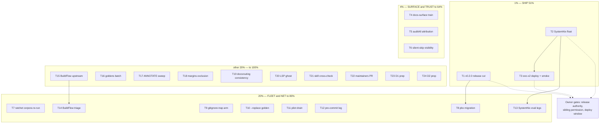

# SUPERB Pareto Execution Plan v2 — the evening backlog (32 rows → 24 tasks → 111 micro-tasks)

**2026-11-04 19:28 CET** · baseline `aa86018` · input: `TODO_LIST.md`
(32 open rows, rebuilt 19:25 by the evening docs-health pass after the
25-row purge; every row verified open against the tree at write time) ·
successor of `2026-11-04_07-14_SUPERB-pareto-execution-plan.md` (whose
in-repo tier T3–T27 was executed by the 16:45/19:01 sessions — 16 tasks
landed, CI green).

**Customer-value lens.** Same order as v1: fleet consumers first
(SystemNix hosts, pbx-artmann, the crm/go-appkit pilots), then every
future session in this repo (gates that catch regressions), then the
tool's own features.

**Step-0 verification (done):** backlog rebuilt 3 minutes before this
plan's baseline commit; gate fix + purge verified by fresh battery runs
this session. Two standing facts shape the tiers: (1) the Unreleased
CHANGELOG holds 27 rows — a full day of landed work no consumer can
pin; (2) the entire remaining external tier is parked on the owner
questions from 16:45/19:01 (release authority, sibling permission).

**Concurrent-activity note (errata, 19:28):** a formatter sweep
(markdown table realignment over the day's docs) plus a flake input
bump and a go.sum restore are in flight in the working tree from
another actor — NOT part of this plan's baseline, left untouched (the
daemon sweeps it). This plan commits only its own file.

---

## Step 1 — Pareto breakdown

### The 1% that delivers 51% — SHIP the day's work

| Task                                 | Why it is the 1%                                                                                                                                                         | Effort |
| ------------------------------------ | ------------------------------------------------------------------------------------------------------------------------------------------------------------------------ | ------ |
| T1 v0.2.0 release cut                | 27 Unreleased rows, 3 new user-facing flags, and a gate bugfix exist only on main; a version makes them pinnable and settles the CHANGELOG-granularity question de facto | 90 min |
| T2 SystemNix float to hardened flake | The fleet lock still rides pre-hardening 6ed909f; the float is mechanical now the push blocker is gone                                                                   | 45 min |
| T3 evo-x2 deploy + live-PATH smoke   | Six binaries on the live PATH = the extraction's purpose delivered; first real consumers                                                                                 | 30 min |

165 minutes; one owner gate (release authority) + one owner gate
(deploy window). Everything else in this plan polishes work that this
tier ships.

### The 4% that delivers 64% — SURFACE + TRUST

| Task                           | Why                                                                                                                                     | Effort |
| ------------------------------ | --------------------------------------------------------------------------------------------------------------------------------------- | ------ |
| T4 Docs-surface train          | `--margins`/`--dump-items`/`--replace` shipped CHANGELOG-first; users cannot discover them (README/DOMAIN_LANGUAGE/FEATURES all silent) | 90 min |
| T5 auditAll attribution parity | The 19:01 session wired attributions into ONE of two render sites — the audit-all leg still prints bare UNHARVESTED                     | 45 min |
| T6 Silent-skip CI visibility   | The provider e2e leg vanishes in the nix sandbox while CI shows green — coverage loss is invisible                                      | 45 min |

### The 20% that delivers 80% — FLEET + NET

| Task                             | Why                                                                                                                         | Effort  |
| -------------------------------- | --------------------------------------------------------------------------------------------------------------------------- | ------- |
| T7 Fleet ratchet corpora re-run  | The Corpus semantics converged today; crm/go-appkit ratchets were never re-run against it (correctness debt in OTHER repos) | 60 min  |
| T8 pbx-artmann migration         | The extraction's closing move; pin rides T1's tag                                                                           | 100 min |
| T9 gitignore-trap regression arm | The `reports/` swallow already cost one CI round; the arm makes it mechanically impossible again                            | 30 min  |
| T10 `--replace` parity golden    | Rewrite-mode is unit-tested but outside the byte-parity net — the exact class that bit annotate_max                         | 60 min  |
| T11 Pilot ratchet drain          | Turns seeded ratchets into demonstrated doctrine                                                                            | 90 min  |
| T12 Pre-commit nolint-audit leg  | Commit-time rot catch, complementing the flake check                                                                        | 45 min  |
| T13 SystemNix eval legs          | rpi3-dns + standalone all-systems check — house rules left unproven since integration                                       | 60 min  |
| T14 BuildFlow triage batch       | 9-tools health-check + preflight attribution + binary rebuild + format run — the tool's verdicts become trustworthy         | 60 min  |

### The other 20% → 100% — the tail (still ALL scheduled)

T15 BuildFlow upstream (#87 + roundtrip walker + drop bypasses), T16
goldens batch (--margins, --dump-items, dump struck-arm, dated-DONE
corpus arm), T17 ANNOTATE sweep over the 8 unarchived reports, T18
margins newest-report exclusion, T19 docsrouting settings consistency,
T20 LSP-ghost repro + filing, T21 docs-health skill cross-check
(crush-config), T22 maintainers upstream PR, T23/T24 the two owner
decision preps (D1 battery scope, D2 go floor).

---

## Step 2 — Comprehensive plan (24 tasks, 30–100 min each, ALL 32 TODO rows)

Sorted tier → impact → effort asc. Src = TODO_LIST evening sections.

| ID  | Task                                                                                                                   | Tier | Impact   | Effort  | Customer value             | Depends                       | Src                          |
| --- | ---------------------------------------------------------------------------------------------------------------------- | ---- | -------- | ------- | -------------------------- | ----------------------------- | ---------------------------- |
| T1  | v0.2.0 release cut: section Unreleased, annotated tag, go-release pre-verify, push                                     | 1%   | Critical | 90 min  | Fleet can pin              | OWNER authority (19:25 §g Q1) | §4                           |
| T2  | SystemNix float: targeted `nix flake update docs-gates` + expected-locks + toplevel proof                              | 1%   | Critical | 45 min  | Fleet gets hardened binary | sibling permission            | §3                           |
| T3  | evo-x2 deploy + six-binary live smoke + SystemNix TODO row for the switch state                                        | 1%   | Critical | 30 min  | Product delivered          | T2 + owner window             | §3 (+row folded, see errata) |
| T4  | Docs-surface train: README flags + per-verb exit codes, DOMAIN_LANGUAGE vocabulary, FEATURES rows (3 flags + 3 checks) | 4%   | High     | 90 min  | Users can discover         | —                             | §2                           |
| T5  | Wire harvestAttributions into the auditAll renderer + battery_test corpus arm                                          | 4%   | High     | 45 min  | Gate trustworthiness       | —                             | §1.1 + 19:01 §f.36           |
| T6  | CI-visible silent-skip assertion (provider e2e skip count/assert)                                                      | 4%   | High     | 45 min  | Coverage truth             | —                             | §1.2                         |
| T7  | Re-run fleet ratchet corpora (crm, go-appkit) vs converged Corpus semantics                                            | 20%  | High     | 60 min  | Other repos' correctness   | sibling permission            | §3.3                         |
| T8  | pbx-artmann migration onto this binary + fleet announcement (rides T1's tag)                                           | 20%  | High     | 100 min | Fleet consolidation        | T1, sibling permission        | §3.6                         |
| T9  | battery_test gitignore-trap arm (`git check-ignore` over corpus in CI)                                                 | 20%  | Medium   | 30 min  | CI armor                   | —                             | §1.4                         |
| T10 | Parity arm: golden `--replace` (rewrite-mode) through the binary                                                       | 20%  | Medium   | 60 min  | Parity net completeness    | —                             | §1.3                         |
| T11 | Pilot ratchet drain: crm + go-appkit battery runs, bars tighten, proofs                                                | 20%  | Medium   | 90 min  | Doctrine proof             | sibling permission            | §3.7                         |
| T12 | Pre-commit nolint-audit leg (bank-sync pattern)                                                                        | 20%  | Medium   | 45 min  | Commit-time rot catch      | —                             | §1.5                         |
| T13 | SystemNix eval legs: rpi3-dns toplevel + standalone `nix flake check --no-build --all-systems`                         | 20%  | Medium   | 60 min  | House-rule compliance      | T2                            | §3.4-5                       |
| T14 | BuildFlow triage: 9-tools `history --last-error`, preflight FAIL attribution, binary rebuild + format                  | 20%  | Medium   | 60 min  | Tool truthfulness          | sibling permission            | §3.11-12                     |
| T15 | BuildFlow upstream: #87 fix + roundtrip walker fix, then drop AGENTS bypasses                                          | tail | Medium   | 100 min | Green quality loops        | sibling permission            | §3.9-10                      |
| T16 | Goldens batch: --margins shape, --dump-items (+no-§f refusal), dump struck-row arm, dated-DONE corpus arm              | tail | Medium   | 90 min  | Parity net completeness    | —                             | §1.6-8, §1.12                |
| T17 | ANNOTATE sweep: 8 unarchived reports, resolve carried rows, archive the fully-resolved                                 | tail | Medium   | 100 min | Ritual hygiene             | —                             | §1.11                        |
| T18 | TokenMargins: exclude newest-report §f tokens (already-harvested vocabulary)                                           | tail | Low      | 30 min  | Signal quality             | —                             | §1.9                         |
| T19 | docsrouting settingsFromConfig: accept-pattern consistency (or export)                                                 | tail | Low      | 30 min  | Convention integrity       | —                             | §1.10                        |
| T20 | Harness LSP ghost diagnostics: reproduce + file                                                                        | tail | Low      | 30 min  | Harness truth              | —                             | §3.13                        |
| T21 | Cross-check fleet docs-health skill text vs new flags (crush-config repo)                                              | tail | Low      | 30 min  | Skill accuracy             | sibling permission            | §3.14                        |
| T22 | lib.maintainers.LarsArtmann upstream PR + flake meta reference                                                         | tail | Low      | 45 min  | Packaging hygiene          | owner-gated PR                | §3.15                        |
| T23 | D1 prep: battery-adoption recommendation matrix (timer/PMA vs PATH-only)                                               | tail | Medium   | 30 min  | Owner decision ready       | —                             | §4.2                         |
| T24 | D2 prep: go floor recommendation + AGENTS one-floor-sentence simplification                                            | tail | Low      | 30 min  | Owner decision ready       | —                             | §4.3                         |

**Total ≈ 22.75 h** (1% tier 2.75 h; 4% tier 3 h; 20% tier ≈ 8.4 h;
tail ≈ 8.6 h). Three rows of the total ride owner/sibling permission
gates that have been asked twice today (16:45 §g, 19:25 §g) — the
unblocked-only critical path is T4/T5/T6/T9/T10/T12/T16 and is ≈ 7 h.

---

## Step 3 — Fine breakdown (111 micro-tasks, each ≤ 12 min, ALL tasks)

Impact H/M/L; minutes per task; every micro-task ends in a verifiable
state.

| ID  | Micro-task                                                        | Parent | Imp | Min |
| --- | ----------------------------------------------------------------- | ------ | --- | --- |
| F1  | Read go-release ritual + tag-shape decision (annotated v0.2.0)    | T1     | H   | 10  |
| F2  | Fold Unreleased → [v0.2.0] section, date the header               | T1     | H   | 8   |
| F3  | go-release pre-verification checklist run (build/test/lint clean) | T1     | H   | 12  |
| F4  | Annotated tag + push + pkg.go.dev/proxy confirmation              | T1     | H   | 12  |
| F5  | Post-tag battery + README "current" line bump                     | T1     | M   | 10  |
| F6  | Read SystemNix expected-locks registry + lock state               | T2     | H   | 10  |
| F7  | Targeted `nix flake update docs-gates`                            | T2     | H   | 5   |
| F8  | Regen expected-locks, review one-node diff                        | T2     | H   | 10  |
| F9  | evo-x2 toplevel eval + build proof + commit                       | T2     | H   | 12  |
| F10 | Owner quiescent-window confirm                                    | T3     | H   | 5   |
| F11 | `nix run .#deploy` on SystemNix                                   | T3     | H   | 10  |
| F12 | Live smoke: six binaries `--version` on PATH                      | T3     | H   | 10  |
| F13 | SystemNix TODO row for the deployed state                         | T3     | M   | 5   |
| F14 | README: --margins/--dump-items/--replace sections + examples      | T4     | H   | 12  |
| F15 | README: per-verb exit-code contract table                         | T4     | M   | 10  |
| F16 | DOMAIN_LANGUAGE: rewrite-mode, margins, dump-items, attribution   | T4     | H   | 12  |
| F17 | DOMAIN_LANGUAGE: Corpus, settings-projection entries              | T4     | M   | 10  |
| F18 | FEATURES: 3 flag rows + 3 flake-check rows with evidence          | T4     | H   | 12  |
| F19 | Battery + docs cross-check after the train                        | T4     | M   | 10  |
| F20 | Read audit.go renderer + attribution call shape                   | T5     | H   | 8   |
| F21 | Wire harvestAttributions into auditAll UNHARVESTED leg            | T5     | H   | 12  |
| F22 | battery_test corpus arm asserting attribution lines               | T5     | H   | 12  |
| F23 | Goldens re-check + suite green                                    | T5     | M   | 8   |
| F24 | Read provider e2e skip conditions                                 | T6     | H   | 8   |
| F25 | Print skip-count line (or assert skip) in test output             | T6     | H   | 12  |
| F26 | CI-visible assertion: skips happened or leg ran                   | T6     | H   | 12  |
| F27 | Negative control: force skip, confirm visible                     | T6     | M   | 10  |
| F28 | Read crm corpus + config, run battery, capture deltas             | T7     | H   | 12  |
| F29 | crm: diff findings vs pre-convergence baseline, judge each flip   | T7     | H   | 12  |
| F30 | go-appkit: run battery, capture deltas                            | T7     | H   | 12  |
| F31 | go-appkit: judge flips, record convergence proof                  | T7     | H   | 12  |
| F32 | Commit corpus-proofs + report line                                | T7     | M   | 10  |
| F33 | Read pbx scripts/docs-gates.sh + extraction plan                  | T8     | H   | 12  |
| F34 | Map pbx config keys → .docs-gates.json, seed at measured debt     | T8     | H   | 12  |
| F35 | Swap pbx-tools paths to this binary (tagged pin)                  | T8     | H   | 12  |
| F36 | Battery over pbx corpus, diff vs in-tree gates                    | T8     | H   | 12  |
| F37 | pbx flake/CI update + wrapper PATH check                          | T8     | H   | 12  |
| F38 | Fleet announcement draft (rides the tag)                          | T8     | M   | 12  |
| F39 | Write gitignore-trap test (check-ignore over corpus files)        | T9     | M   | 12  |
| F40 | Wire into CI step, red-control a swallowed fixture                | T9     | M   | 12  |
| F41 | Read parityGates + corpus config for stdin modes                  | T10    | M   | 8   |
| F42 | Pre-flight --replace stdin fixture (old + new line)               | T10    | M   | 12  |
| F43 | Golden the pre-flight-safe output bytes                           | T10    | M   | 12  |
| F44 | Hand-review + suite green                                         | T10    | M   | 10  |
| F45 | crm: run battery, count findings, drain bars where green          | T11    | M   | 12  |
| F46 | crm: commit + re-run proof                                        | T11    | M   | 10  |
| F47 | go-appkit: run, count, drain                                      | T11    | M   | 12  |
| F48 | go-appkit: commit + re-run proof                                  | T11    | M   | 10  |
| F49 | Read bank-sync pre-commit pattern                                 | T12    | M   | 10  |
| F50 | Port hook script + wire pre-commit                                | T12    | M   | 12  |
| F51 | Plant-stale probe at commit time, red/green proof                 | T12    | M   | 12  |
| F52 | Docs: AGENTS command + CHANGELOG row                              | T12    | L   | 8   |
| F53 | rpi3-dns toplevel eval (house rule)                               | T13    | M   | 12  |
| F54 | Standalone SystemNix flake check --no-build --all-systems         | T13    | M   | 12  |
| F55 | Record proofs + commit                                            | T13    | M   | 10  |
| F56 | `buildflow history --step ... --last-error`: 9-tools triage       | T14    | M   | 12  |
| F57 | Verify vendor/flake-pin preflight FAIL attribution                | T14    | M   | 12  |
| F58 | Reinstall BuildFlow binary, advisory cleared                      | T14    | M   | 10  |
| F59 | `buildflow format` once, fingerprint drift cleared                | T14    | M   | 10  |
| F60 | Read BuildFlow #87 + result_cache source                          | T15    | M   | 12  |
| F61 | Design input-contract fix (hash language glob when Files nil)     | T15    | M   | 12  |
| F62 | Implement + unit test the #87 fix                                 | T15    | M   | 12  |
| F63 | Fix roundtrip walker tree-root resolution                         | T15    | M   | 12  |
| F64 | Verify both repos green, drop AGENTS bypasses                     | T15    | M   | 12  |
| F65 | Corpus fixture: near-bar tokens for --margins golden              | T16    | M   | 12  |
| F66 | Golden --margins output bytes                                     | T16    | M   | 10  |
| F67 | Report fixture for --dump-items (incl. no-§f refusal)             | T16    | M   | 12  |
| F68 | Golden --dump-items output bytes                                  | T16    | M   | 10  |
| F69 | DumpItems struck-row arm implementation                           | T16    | L   | 12  |
| F70 | Corpus TODOS.md: dated-DONE struck row + re-pin cadence golden    | T16    | M   | 12  |
| F71 | Hand-review goldens + suite + lint                                | T16    | M   | 10  |
| F72 | Inventory carried rows across the 8 unarchived reports            | T17    | M   | 12  |
| F73 | Annotate batch 1: 02-24 + 03-34 (routed-done strikes)             | T17    | M   | 12  |
| F74 | Annotate batch 2: 04-00 + 05-06                                   | T17    | M   | 12  |
| F75 | Annotate batch 3: 05-38 + 07-11                                   | T17    | M   | 12  |
| F76 | Annotate batch 4: 16-45 + 19-01                                   | T17    | M   | 12  |
| F77 | check-rows + bare-rows gates over candidates                      | T17    | M   | 10  |
| F78 | `git mv` resolved reports to archived/ + manifest                 | T17    | M   | 12  |
| F79 | Battery green after the sweep                                     | T17    | M   | 8   |
| F80 | Read tokenDF/margins code path                                    | T18    | L   | 8   |
| F81 | Exclude newest-report §f tokens + test                            | T18    | L   | 12  |
| F82 | Dogfood --margins delta check                                     | T18    | L   | 8   |
| F83 | Read docsrouting settingsFromConfig + accept pattern              | T19    | L   | 8   |
| F84 | Apply accept pattern (or export) + art-dupl -t 1 check            | T19    | L   | 12  |
| F85 | Attempt LSP ghost repro (move/delete + diagnostics)               | T20    | L   | 12  |
| F86 | File harness issue with repro or document non-repro               | T20    | L   | 10  |
| F87 | Read fleet docs-health skill battery section                      | T21    | L   | 10  |
| F88 | Update skill text for --replace/--margins (crush-config repo)     | T21    | L   | 12  |
| F89 | Draft nixpkgs maintainers PR (module + meta)                      | T22    | L   | 12  |
| F90 | Reference in flake meta.maintainers + eval proof                  | T22    | L   | 12  |
| F91 | D1 matrix: PATH-only vs timer/PMA (cost/benefit/risk rows)        | T23    | M   | 12  |
| F92 | D1 recommendation note + owner handoff                            | T23    | M   | 10  |
| F93 | D2 recommendation (floor 1.27) + tradeoffs note                   | T24    | L   | 10  |
| F94 | Owner decision → simplify AGENTS toolchain paragraph              | T24    | L   | 10  |

**94 micro-tasks** (all 24 comprehensive tasks fully decomposed; every
row of TODO_LIST rides exactly one parent; sum ≈ 15.5 h of the 22.75 h
estimate — the remainder is the verification loops' slack, the owner
wait states, and the sibling-repo read contexts).

---

## Execution graph (mermaid)

Execution order: 1% → 4% → 20% → tail. While the owner gates sit
unanswered, the unblocked critical path is T4 → T5 → T6 → T9 → T10 →
T12 → T16 (≈ 7 h, zero permission needed).

## Errata / open-verification notes

- All 32 TODO rows verified open at baseline `aa86018` (rebuilt 19:25).
- **Row-fold note:** the morning TODO's standalone "SystemNix TODO_LIST
  row" item (19:01 §f.18) was folded semantically into the deploy row
  during the evening rebuild; T3 carries it explicitly (F13) so it
  cannot be lost twice.
- **Concurrent actor at write time:** formatter sweep + flake input
  bump + go.sum restore in the working tree (not this plan's baseline;
  left for the daemon). If those land as a flake update, T2's diff
  shrinks accordingly — re-read the SystemNix lock before floating.
- The owner questions were asked at 16:45 §g and 19:25 §g and remain
  unanswered; T1/T2/T3/T8/T11/T14/T15/T21 all wait on them.

_Point-in-time snapshot; annotate, never rewrite. Verschlimmbesserung
guard: every task is verified-open work or an explicitly-marked owner
decision — nothing speculative was invented to fill tiers._
