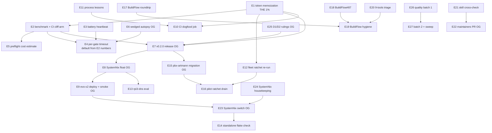

# SUPERB Efficiency Plan — Killing the audit-all Cliff (token memoization, battery UX, the whole board)

**2026-11-05 02:50 CET** · baseline `3adeca7` · inputs: `TODO_LIST.md`
(41 open rows across §1/§2c/§2d/§3/§4, verified open at write time),
the 02-15 fleet-dogfood report (first external battery runs), and a
source-level read of the freshness hot path.

**Trigger.** The first real external use of the battery wedged for
hours: `docs-gates run` over CV died in `audit-all` (1,643 reports ×
~2,000 living-doc lines), a previous session's identical run sat wedged
7 h at 0% CPU, and the battery printed NOTHING while it crawled. The
tool that gates the fleet's docs cannot itself survive the fleet's
largest doc corpus. This plan fixes the cliff, makes wedges visible and
bounded, and schedules the ENTIRE remaining board behind it.

**Customer-value lens.** Fleet consumers first (the hosts and pilots
that run the binary), then every future session in this repo (gates
that catch regressions cheaply), then the tool's own surface. "We need
to get more efficient" covers BOTH the tool's runtime and our session
process — the 02-15 session also burned user time on an unsized launch
and broken exit-code capture; both get mechanical fixes here.

---

## Step 0 — verification + errata (done at write time)

1. **Hot path VERIFIED in source (not inherited from the report):**
   `loadLivingDocs` builds the `tokenDF` closure ONCE per run
   (`corpus.go:103-107`) — the 02-15 report's phrasing "DF recomputed
   per report" is WRONG in mechanism. The observable cost is the same:
   every `tokenPresent` call scans ALL living lines + ALL squashed
   lines (`tokens.go:70-87`), every `tokenDF` call rescans ALL raw
   lines (`corpus.go:115-127`), and the SAME tokens recur across all
   1,643 reports. Per run: ~reports × items × tokens × 3 full-corpus
   scans ≈ 10⁹ `strings.Contains` for CV. **The fix is memoization per
   prepared corpus — a pure cache of a pure function; output bytes
   cannot change.** TODO_LIST §2d row 1 is reworded to match (this
   plan's errata commit).
2. **"Short-circuit zero-open-item reports" (§2d row 4) is
   near-worthless:** `CheckReport` already returns nil for reports
   without a §f (`check.go:50-52`), and item extraction is one file
   read + regex — the token matching is the cost, not the extraction.
   Deprioritized to the tail; the memoization subsumes most of it.
3. **auditAll attribution parity is DONE** (d92f7f8, seen in
   `audit.go:28`) — excluded despite the 19:01 report listing it in §b.
4. All §2/§2b struck rows re-checked as DONE; only §1's single ANNOTATE
   row and the rows named below remain open.
5. Counts at baseline: 13 unarchived reports (threshold 15), 20 struck
   TODO rows (threshold 20 — purge pressure, scheduled), TODO_LIST
   carries 41 open rows.

**Verschlimmbessern guardrails (bind EVERY task in this plan):**

- Byte-parity goldens are the tripwire: a perf change must leave
  `go test ./internal/battery/` green WITHOUT `PARITY_UPDATE`. Any
  output-byte change from a perf task is a BUG, not a re-pin.
- NO goroutines in the gate path. `gatecli.CaptureOutput` swaps
  process-global stdout (AGENTS fact); parallel token matching buys
  maybe 2-4× at real determinism risk. The memo buys 30-100× alone.
- Every perf task lands red→green: a failing benchmark (or a planted
  regression) before the fix, the same benchmark green after.
- No new dependencies (stdlib-only root contract), no config-format
  changes, no changes to the five legacy wrapper argv shapes.

---

## Step 1 — Pareto breakdown

### The 1% that delivers 51% — MEMOIZE THE TOKEN MATCHES

| Task                          | Why it is the 1%                                                                                                                                                                       | Effort  |
| ----------------------------- | ------------------------------------------------------------------------------------------------------------------------------------------------------------------------------------- | ------- |
| E1 token memoization          | One bounded cache in the prepared `Corpus` (`token -> present, DF`), wired under `Contains`/`Count`. Pure function of (token, corpus), so verdicts are byte-identical while CV's audit-all goes from HOURS to minutes. Every fleet repo benefits on every run. | 90 min  |

### The 4% that delivers 64% — MAKE THE COST VISIBLE AND BOUNDED

| Task                          | Why                                                                                                                                                                                    | Effort  |
| ----------------------------- | ------------------------------------------------------------------------------------------------------------------------------------------------------------------------------------- | ------- |
| E2 benchmark + CI cliff arm   | A repeatable corpus-size benchmark (go-health real + a synthesized ~1.6k-report corpus fixture) so the cliff is a NUMBER, and a CI arm that fails on runtime regression. Without it E1's win erodes silently. | 75 min  |
| E3 battery heartbeat          | Per-gate elapsed line while running (and a final per-gate duration in the matrix). A crawling/wedged gate becomes visible WITHOUT ps forensics — exactly what the 02-15 session lacked.  | 45 min  |
| E4 battery per-gate timeout   | Wall-clock cap per gate mapping onto the existing FAIL row `(rc=2)` convention as `(rc=timeout)` — the battery NEVER hangs forever again. Default generous; config knob rides Settings. | 75 min  |

### The 20% that delivers 80% — SHIP IT, JUDGE OURSELVES, LEARN

| Task                          | Why                                                                                                                                                                                    | Effort   |
| ----------------------------- | ------------------------------------------------------------------------------------------------------------------------------------------------------------------------------------- | -------- |
| E5 preflight cost estimate    | `audit-all` prints reports × living-lines + a duration estimate BEFORE replaying; unsized launches become impossible-by-design (the 02-15 session mistake, mechanized away).           | 30 min   |
| E6 wedged-process autopsy     | strace/gdb one 0%-CPU docs-gates straggler (CV 7 h one): pipe-block vs futex vs loop informs E4's default and closes the mystery class. Owner OK needed to touch foreign PIDs.        | 45 min   |
| E7 v0.2.0 release cut         | P1 board row: 27+ Unreleased rows incl. the new flags; a tag makes the perf win pinnable by every consumer. Owner-gated (release authority).                                            | 90 min   |
| E8+E9 SystemNix float + deploy| P1 board rows: fleet lock rides pre-hardening 6ed909f; float + evo-x2 deploy put the FAST binary on the live PATH. Owner-gated (deploy window).                                          | 75 min   |
| E10 CI dogfood battery job    | Board row: `go run ./cmd/docs-gates run .` in CI — the gates judge the repo that defines green, on every push, not just dev machines. Pairs with E2's synthetic corpus.                | 45 min   |
| E11 process lessons encoded   | Size-before-launch + never-pipe-then-`$?` + point-in-time-gating-under-daemons written where future sessions actually read them (AGENTS.md fact + crush-config lessons.md row).        | 30 min   |

### The other 20% → 100% — the tail (ALL still scheduled)

E12 fleet ratchet corpora re-run (crm/go-appkit), E13 rpi3-dns eval,
E14 SystemNix standalone all-systems check, E15 pbx-artmann migration,
E16 pilot ratchet drain, E17 BuildFlow roundtrip upstream, E18
BuildFlow#87 upstream, E19 BuildFlow hygiene (binary+format), E20
buildflow 9-tools triage, E21 docs-health skill cross-check
(crush-config), E22 nixpkgs maintainers PR, E23 SystemNix switch,
E24 SystemNix housekeeping batch (push decision + reboot attribution +
pma storm docs), E25 owner decisions D1/D2 (preps written — need
rulings), E26 §2c quality batch 1 (safe-strike harness, --battery
flag, golangci drift guard, actionlint+shellcheck), E27 §2c quality
batch 2 + §1 sweep (margins doc, LSP rows, F94, dependabot, README
scripts, purge pass, ANNOTATE sweep at cadence pressure).

---

## Step 2 — Comprehensive plan (27 tasks, 30–100 min each, ALL 41 TODO rows)

Sorted: tier → customer impact → effort asc. OG = owner-gated.

| #   | Task (30–100 min)                                                                       | Tier | Impact | Effort | Covers TODO rows                              |
| --- | --------------------------------------------------------------------------------------- | ---- | ------ | ------ | ---------------------------------------------- |
| E1  | Token memoization in the prepared Corpus (present+DF cache; byte-identical output)       | 1%   | 10     | 90 min | §2d.1 (reworded), subsumes §2d.2               |
| E2  | Benchmark harness + synthesized ~1.6k-report corpus + CI runtime-regression arm          | 4%   | 9      | 75 min | §2d.6                                         |
| E3  | Battery heartbeat: per-gate elapsed line + duration in the verdict matrix                | 4%   | 8      | 45 min | §2d.3                                         |
| E4  | Battery per-gate wall-clock timeout → FAIL row `(rc=timeout)`; config knob               | 4%   | 8      | 75 min | §2d.4                                         |
| E5  | audit-all preflight cost line: reports × living-lines + estimate before replay           | 20%  | 7      | 30 min | §2d.5                                         |
| E6  | Wedged-process autopsy (strace a 0%-CPU straggler; pipe vs futex vs spin)                | 20%  | 6      | 45 min | §2d.7 (needs owner OK on foreign PIDs)         |
| E7  | v0.2.0 release cut (CHANGELOG section, annotated tag, go-release ritual) **OG**          | 20%  | 9      | 90 min | §4 release row                                 |
| E8  | SystemNix float to hardened flake (`nix flake update docs-gates` + proofs) **OG**        | 20%  | 8      | 45 min | §3 row 1                                       |
| E9  | evo-x2 deploy + live-PATH smoke (six binaries) **OG**                                    | 20%  | 8      | 30 min | §3 row 2                                       |
| E10 | CI dogfood job: battery over THIS repo on every push                                     | 20%  | 7      | 45 min | §2c CI-dogfood row                             |
| E11 | Process lessons encoded (AGENTS.md fact + crush-config lessons.md)                       | 20%  | 6      | 30 min | 02-15 report §e; new                          |
| E12 | Fleet ratchet corpora re-run (crm, go-appkit) vs converged Corpus semantics              | 20%  | 7      | 60 min | §3 row 3                                       |
| E13 | rpi3-dns toplevel eval post lars-packages change                                         | 20%  | 5      | 30 min | §3 row 4                                       |
| E14 | SystemNix standalone `nix flake check --no-build --all-systems`                          | 20%  | 5      | 60 min | §3 row 5                                       |
| E15 | pbx-artmann migration onto this binary (fleet closing move) **OG**                       | 20%  | 8      | 100 min| §3 row 6                                       |
| E16 | Pilot ratchet drain in crm + go-appkit (tighten pins as debt drains)                     | 20%  | 7      | 90 min | §3 row 7                                       |
| E17 | BuildFlow nix-fmt/treefmt roundtrip `/nix/store` walker — file/fix upstream               | tail | 5      | 100 min| §3 row 8                                       |
| E18 | BuildFlow#87 constant cache key — fix upstream, drop AGENTS bypass                       | tail | 5      | 100 min| §3 row 9                                       |
| E19 | BuildFlow hygiene: binary rebuild + one `buildflow format` run                            | tail | 4      | 60 min | §3 row 10                                      |
| E20 | buildflow "9 tools unavailable" triage + preflight FAIL attribution                      | tail | 4      | 30 min | §3 row 11                                      |
| E21 | docs-health skill cross-check vs new flags (crush-config repo)                           | tail | 4      | 30 min | §3 row 12                                      |
| E22 | nixpkgs `lib.maintainers.LarsArtmann` PR + flake meta reference **OG**                   | tail | 4      | 45 min | §3 row 13                                      |
| E23 | SystemNix switch (golangci analysis-cache wrapper goes live) **OG**                      | tail | 6      | 30 min | §3 row 14                                      |
| E24 | SystemNix housekeeping batch: push ruling + reboot attribution + pma storm docs          | tail | 3      | 90 min | §3 rows 15–17                                  |
| E25 | Owner decisions D1 (battery scope) + D2 (go floor) — rulings on written preps **OG**     | tail | 6      | 30 min | §4 D1+D2 rows                                  |
| E26 | §2c quality batch 1: safe-strike test harness, safe-strike --battery, golangci drift guard, actionlint+shellcheck devshell | tail | 5 | 100 min | §2c rows 1–2, 4–5 |
| E27 | §2c batch 2 + §1: margins DF fact, post-activation LSP note, LSP cold-cache leg, F94 AGENTS compression, dependabot, README scripts section, struck-row purge pass, ANNOTATE sweep at cadence pressure | tail | 4 | 100 min | §2c rows 3, 6–12 + §1 row |

**Total: 27 tasks · ~21.6 h · every open TODO row covered · 6 owner
gates (E6 PID access, E7 release, E8/E9 deploy+float, E15 sibling
permission, E22 external PR, E23 switch, E25 rulings).**

---

## Step 3 — Detailed breakdown (ALL tasks, max 12 min each)

Verify column = the red→green or byte-parity proof that closes the
micro-task. B = benchmark from E2 (where used before E2 lands, a
timing loop in a scratch test stands in).

### E1 token memoization (the 1%)

| ID  | Micro-task (≤12 min)                                                       | Est | Verify                                    |
| --- | -------------------------------------------------------------------------- | --- | ----------------------------------------- |
| 1.1 | Write the failing slow-path probe: scratch test timing `CheckReport` over go-health corpus, recorded as the BEFORE number | 12 | number in test output                     |
| 1.2 | Add `memo` fields to `Corpus` (maps: token→present, token→DF) + constructor init | 12 | compiles, no behavior change              |
| 1.3 | Route `Contains` through the present-memo (raw+squash arms preserved exactly) | 12 | `go test ./internal/docsfreshness/`       |
| 1.4 | Route `Count` through the DF-memo                                          | 12 | same                                       |
| 1.5 | Equivalence test: memoized vs naive over the parity corpus vocabulary — identical verdicts | 12 | test green, planted-diff red              |
| 1.6 | Wire `loadLivingDocs`/`auditAll`/`checkNewest` to the memoized corpus (no signature churn: closures already flow) | 12 | builds                                     |
| 1.7 | Run full root suite + battery parity goldens — byte-identical, NO re-pin     | 12 | `go test ./...` green untouched goldens   |
| 1.8 | AFTER timing: same probe as 1.1, record speedup                            | 12 | number ≥ 10× (expect 30–100×)             |
| 1.9 | Fleet lint 0 + erraudit rc 0 over root                                     | 12 | both clean                                 |
| 1.10| Land train: code + tests + CHANGELOG row, commit                            | 12 | git log                                    |

### E2 benchmark + CI cliff arm

| ID  | Micro-task                                                                  | Est | Verify                                  |
| --- | --------------------------------------------------------------------------- | --- | --------------------------------------- |
| 2.1 | Benchmark func: time `audit-all` over go-health corpus (testing.B or timed test, short mode) | 12 | prints ns/op                            |
| 2.2 | Synthesize ~1.6k-report corpus generator (script or testdata maker, deterministic content) | 12 | fixture builds                          |
| 2.3 | Big-corpus benchmark run: record pre-E1 number (or skip if E1 landed: cite 1.1's model) | 12 | number recorded                        |
| 2.4 | CI arm: job step runs the benchmark with a generous wall ceiling            | 12 | CI green; planted slowdown trips it locally |
| 2.5 | Commit synthesized corpus under testdata (check gitignore trap: `git check-ignore`) | 12 | tracked count verified                 |

### E3 battery heartbeat

| ID  | Micro-task                                                                  | Est | Verify                                  |
| --- | --------------------------------------------------------------------------- | --- | --------------------------------------- |
| 3.1 | Time each gate in `battery.Run` (start/stop around the existing fn call)    | 12 | compiles                                |
| 3.2 | Print `gate X ... (Y.Zs)` completion line per gate                           | 12 | output shows durations                  |
| 3.3 | Add duration column to the verdict matrix rows                              | 12 | matrix renders                          |
| 3.4 | Decide + implement: duration lines on stdout vs gate output stream (CaptureOutput interplay) | 12 | serial tests stay green; no t.Parallel additions |
| 3.5 | INTENTIONAL output change: re-pin goldens via `PARITY_UPDATE=1`, hand-diff  | 12 | diff reviewed, commit                   |

### E4 battery per-gate timeout

| ID  | Micro-task                                                                  | Est | Verify                                  |
| --- | --------------------------------------------------------------------------- |
| 4.1 | Design note (20 lines): goroutine+timer kill switch, `(rc=timeout)` row, default value from E2 numbers | 12 | note in PR/commit body |
| 4.2 | Timeout wrapper around gate fn (context-free: goroutine + select, output capture caveat) | 12 | compiles |
| 4.3 | FAIL row rendering for timeout, message names the gate + elapsed             | 12 | unit test |
| 4.4 | Config knob `gate_timeout_sec` in config + Settings projection (zero = default) | 12 | config test |
| 4.5 | Discrimination: planted infinite-loop gate test → battery returns in ≤ default, row says timeout | 12 | test red→green |
| 4.6 | Matrix exit arithmetic: timeout row counts as FAIL (exit 1) — test           | 12 | test green |

### E5 preflight cost estimate

| ID  | Micro-task                                                                  | Est | Verify                                  |
| 5.1 | Count reports + living lines before replay; print `audit-all: N reports × M lines, est ~T` | 12 | output line |
| 5.2 | Estimate formula from E2 numbers (linear fit, conservative)                  | 12 | comment + test |
| 5.3 | Golden re-pin (intentional), hand-diff, commit                               | 12 | diff reviewed |

### E6 wedged autopsy

| ID  | Micro-task                                                                  | Est | Verify                                  |
| 6.1 | Owner OK + identify oldest straggler PID; `ps` state + `/proc/PID/stack`, `wchan` | 12 | wchan named |
| 6.2 | `strace -p PID` 60 s (or `gdb -p` thread apply all bt)                       | 12 | syscall named |
| 6.3 | Write the mechanism + AGENTS.md fact (pipe vs futex vs spin); inform E4 default | 12 | AGENTS row |
| 6.4 | Kill the stragglers if owner approved; note in 02-15 report appendix         | 12 | ps clean |

### E7 v0.2.0 release **OG**

| ID  | Micro-task                                                                  | Est | Verify                                  |
| 7.1 | Owner ruling: release authority + timing                                    | 12 | answer recorded |
| 7.2 | CHANGELOG Unreleased → 0.2.0 section cut, date, links                        | 12 | section renders |
| 7.3 | Pre-release verify: suite, lint both modules, parity, `nix flake check --no-build --all-systems` | 12 | all green |
| 7.4 | go-release ritual: annotated tag, push, proxy/pkg.go.dev watch               | 12 | tag visible |
| 7.5 | Fleet announcement draft (rides the release)                                | 12 | draft saved |

### E8+E9 SystemNix float + deploy **OG**

| ID  | Micro-task                                                                  | Est | Verify                                  |
| 8.1 | `nix flake update docs-gates` in SystemNix; expected-locks regen             | 12 | lock diff = new rev                      |
| 8.2 | evo-x2 toplevel build proof                                                 | 12 | build green                              |
| 8.3 | rpi3-dns toplevel eval (E13 rides along)                                    | 12 | eval green                               |
| 8.4 | Owner window: `nix run .#deploy` + live-PATH smoke of all six binaries       | 12 | `docs-gates --version` on host           |

### E10 CI dogfood job

| ID  | Micro-task                                                                  | Est | Verify                                  |
| 10.1 | ci.yml `dogfood` job: `go run ./cmd/docs-gates run .`                        | 12 | CI green on this repo                    |
| 10.2 | Handle the repo's own 13-report corpus vs thresholds (should pass as-is)     | 12 | job green locally first                  |

### E11 process lessons encoded

| ID  | Micro-task                                                                  | Est | Verify                                  |
| 11.1 | AGENTS.md non-obvious fact: size-before-launch + point-in-time gating under daemons | 12 | row present |
| 11.2 | crush-config `references/lessons.md`: never-pipe-then-`$?` (PIPESTATUS) — committed there, not in-session | 12 | commit in that repo |
| 11.3 | AGENTS.md cost-model fact (§2d.8) folded into the same pass                  | 12 | row present |

### E12 fleet ratchet re-run

| ID  | Micro-task                                                                  | Est | Verify                                  |
| 12.1 | crm: battery/audit-all run post-memoization, ratchet pin check               | 12 | numbers recorded                         |
| 12.2 | go-appkit: same                                                             | 12 | numbers recorded                         |
| 12.3 | Divergence triage if any (token semantics) + report rows                     | 12 | rows written                             |

### E13–E14 SystemNix evals

| ID  | Micro-task                                                                  | Est | Verify                                  |
| 13.1 | rpi3-dns toplevel eval (if not already ridden in 8.3)                        | 12 | eval green                               |
| 14.1 | Standalone `nix flake check --no-build --all-systems` on SystemNix           | 12 | check green                              |

### E15 pbx-artmann migration **OG**

| ID  | Micro-task                                                                  | Est | Verify                                  |
| 15.1 | Owner permission + read pbx-tools docs-gates consumption sites               | 12 | sites listed                             |
| 15.2 | Swap wrappers to this binary (five legacy names ride it unchanged)           | 12 | wrappers exec new binary                 |
| 15.3 | pbx corpus battery green (or ratchet pins set)                               | 12 | run green                                |
| 15.4 | Fleet-wide announcement post-E7                                             | 12 | sent                                     |

### E16 pilot ratchet drain

| ID  | Micro-task                                                                  | Est | Verify                                  |
| 16.1 | crm: drain N findings, lower audit_max, commit pins                          | 12 | pin lowered, gate green                 |
| 16.2 | go-appkit: same                                                             | 12 | pin lowered, gate green                 |
| 16.3 | Doctrine note: drain cadence for pilots                                     | 12 | note written                             |

### E17–E20 BuildFlow batch (upstream + hygiene)

| ID  | Micro-task                                                                  | Est | Verify                                  |
| 17.1 | Roundtrip walker bug: minimal repro in BuildFlow repo, fix, tests            | 12 | repro red→green                          |
| 17.2 | Upstream commit/PR + drop the AGENTS "do not fix here" bullet                | 12 | PR link in row                           |
| 18.1 | BuildFlow#87: FileContract inputs = actual config files, cache key content-hashed | 12 | repro test                               |
| 18.2 | Drop `BUILDFLOW_NO_RESULT_CACHE=1` bypass from AGENTS after fix verified     | 12 | AGENS row gone                           |
| 19.1 | Rebuild/reinstall BuildFlow binary; `buildflow format` once                  | 12 | advisories clear                         |
| 20.1 | `buildflow history --step ... --last-error` on 9-tools + preflight attribution | 12 | diagnosis written                        |

### E21–E22 external docs/PRs

| ID  | Micro-task                                                                  | Est | Verify                                  |
| 21.1 | crush-config: docs-health skill battery section vs --replace/--margins/--dump-items | 12 | diff written                        |
| 22.1 | nixpkgs maintainers PR (module team etiquette, birthdate format)             | 12 | PR open                                 |
| 22.2 | Reference `lib.maintainers.LarsArtmann` in flake meta.maintainers            | 12 | eval green                              |

### E23–E24 SystemNix switch + housekeeping

| ID  | Micro-task                                                                  | Est | Verify                                  |
| 23.1 | Owner window: `nixos-rebuild switch` (or deploy lane), wrapper live          | 12 | cache dir per-process                    |
| 24.1 | Push ruling on the 4-ahead train; push if approved                           | 12 | origin updated                           |
| 24.2 | Reboot attribution via journalctl boot 91b4a3a2                             | 12 | answer in row                            |
| 24.3 | pma queue-full storm + FastFlowLM window → SystemNix monitoring docs         | 12 | doc row                                  |

### E25 owner decisions **OG**

| ID  | Micro-task                                                                  | Est | Verify                                  |
| 25.1 | D1 ruling on written matrix (PATH-only quarter vs timer/PMA)                 | 12 | ruling recorded in §4                    |
| 25.2 | D2 ruling (go floor 1.27 with v0.2.0); simplify AGENTS toolchain paragraph   | 12 | AGENTS one sentence                      |

### E26 §2c quality batch 1

| ID  | Micro-task                                                                  | Est | Verify                                  |
| 26.1 | `scripts/safe-strike-test.sh`: 9-case refusal matrix harness                 | 12 | all 9 refuse correctly                   |
| 26.2 | safe-strike `--battery` flag (whole battery per batch)                       | 12 | flag runs battery                        |
| 26.3 | Golangci drift guard script (flake pin vs ci.yml action version)             | 12 | planted drift trips it                   |
| 26.4 | actionlint + shellcheck into devShell                                        | 12 | both run on a dirty fixture              |

### E27 §2c batch 2 + §1

| ID  | Micro-task                                                                  | Est | Verify                                  |
| 27.1 | Margins DF arithmetic fact in AGENTS                                        | 12 | row present                              |
| 27.2 | Post-activation LSP note (pending E23)                                      | 12 | row present                              |
| 27.3 | LSP cold-cache experiment IF ghosts persist post-E23                        | 12 | result recorded                          |
| 27.4 | F94 AGENTS compression pass (owner-gated)                                   | 12 | section shorter, nothing lost            |
| 27.5 | Dependabot enrollment (`buildflow -s dependabot-auto-configure`)            | 12 | config.yml present                       |
| 27.6 | README Scripts section (safe-strike, stack-drift, erraudit-rev)             | 12 | section renders                          |
| 27.7 | Struck-row purge pass (20 struck → CHANGELOG) before threshold trips         | 12 | cadence green, count reset               |
| 27.8 | ANNOTATE sweep at cadence pressure only (scoped: ledgers carry open rows)    | 12 | battery green                            |

**Micro-task total: 96 · every E-task decomposed · every estimate ≤ 12 min.**

---

## Execution graph

**Order of attack for the next execution session:** E1 → E2 → E3 → E5
(one train, all green same day, ~4 h incl. verification) → E4 (informed
by E2+E6) → E7 onward down the owner-gated chain. The in-repo tier
(E1–E5, E10, E11, E26, E27) needs NO permissions and is ~8 h of
verified work.

---

*Plan snapshot; the living source of these rows is `TODO_LIST.md`.
Errata for this plan's own claims: TODO §2d.1 reworded at commit time
(mechanism correction, see Step 0.1). Do not verschlimmbessern: byte
parity, no goroutines, red→green on every perf task.*
