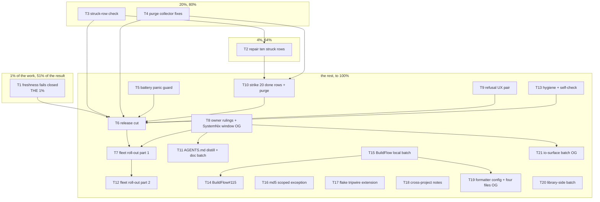

# SUPERB Pareto Execution Plan v3 — judge integrity first, then the whole board

**2026-11-24 01:11 CET** · baseline `5ffab19` · inputs: `TODO_LIST.md` (97 open
table rows: 67 open work, 20 already done, 10 corrupted struck rows; line
numbers are those of TODO_LIST.md at baseline), `ROADMAP.md`, the 2026-11-24
00:12 status report and its harvest ledger, the two earlier plans in this
directory, the dispatch queue (empty for this repo at 00:45) and a
re-derivation of every in-repo row against code, tests, CI and tags.

**Trigger.** The audit session found that the judge lies in three ways:
freshness passes by omission and by coincidence, ten struck rows are
corrupted and invisible, and purge would write a malformed bullet. At the
same time the board grew to 97 open rows while main was red in CI.
This plan puts the judge's own truthfulness first and schedules everything
else behind it.

**Customer-value lens.** Fleet consumers first (they run the battery and
need verdicts that are true), then every future session in this repo
(honest gates catch regressions cheaply), then the owner's time (eleven
stale rulings batched into one sitting).

---

## Step 0 — verification + errata (done at write time)

Every one of the 97 table rows was re-derived against code, tests,
CI and tags before ranking. Three things changed the board.

**A. 20 open rows are already done.** They stay on the board until
struck with evidence (T10). Each evidence line below was checked today.

| Row  | The row asked for                                   | Evidence it is done                                                                                                                        |
| ---- | --------------------------------------------------- | ------------------------------------------------------------------------------------------------------------------------------------------ |
| L45  | Go floor decision (1.26 or 1.27)                    | both modules say `go 1.27`; AGENTS.md carries one floor sentence                                                                           |
| L52  | Cut v0.3.1                                          | tag `v0.3.1` exists, followed by v0.4.0 and v0.5.0                                                                                         |
| L60  | golangci run.go floor versus the root floor         | `.golangci.yml` runs at 1.27, the same as the root module                                                                                  |
| L68  | A golden for the land-parity messages               | `testdata/parity/golden/land-parity.txt` and `land-parity-drift.txt`, wired in `internal/battery/parity_test.go`                           |
| L69  | Direct carrier tests                                | `internal/config/config_carrier_test.go`, `internal/docspurge/docspurge_carrier_test.go`, `internal/docsstrike/docsstrike_carrier_test.go` |
| L72  | safe-strike UX: echo positionals, multi-row batches | `scripts/safe-strike.sh` prints its usage on a refusal and has `--batch`                                                                   |
| L74  | Provider hint pins a version                        | `pkg/provider/provider.go` suggests `@v0.5.0`                                                                                              |
| L75  | A `--clear-stamp` flag                              | `internal/docsfreshness/preflight_land.go` and the usage text carry it                                                                     |
| L76  | Test the provider without the binary on PATH        | `TestHealthCheckReportsMissingBinary` in `pkg/provider/provider_test.go`                                                                   |
| L77  | Model deliberate duplicate headings                 | the `--duplicates` flag in `internal/docsfreshness/preflight_refusals.go`                                                                  |
| L86  | Watch the first CI race run                         | `.github/workflows/ci.yml` runs `go test -race ./...` in both jobs; the run list shows green pushes since 11-23 until `adfa9c8`            |
| L88  | File the treefmt hooks noise upstream               | BuildFlow's AGENTS.md mentions `hooksPath` and the refusal                                                                                 |
| L90  | Arm the local pre-commit hooks                      | `.git/hooks/pre-commit` is present and ran on `b152739` (nolint-audit passed)                                                              |
| L93  | Provider CI job with the race detector              | the provider job runs `go test -race ./...`                                                                                                |
| L94  | One deliberate `--json` timeout run                 | `TestRunJSONTimeoutRow` and `TestRunGateTimeoutBoundsTheBattery`                                                                           |
| L95  | A visible marker when hash verification is skipped  | `internal/docsannotate/docsannotate.go` prints that the hash and tag rules are skipped                                                     |
| L96  | The six-layer incident narrative                    | `docs/agent-notes.md` carries it                                                                                                           |
| L98  | Split `gatecli_test.go` before it grows             | the file is 168 lines today (ceiling 350)                                                                                                  |
| L99  | The battery names safe-strike on failure            | `internal/battery/battery.go` prints the hint (seen in today's output)                                                                     |
| L112 | File the io-surface findings upstream               | io-surface's TODO_LIST.md mentions docs-gates                                                                                              |

**B. 8 rows rest on a stale premise.** Each is reworded by its task

| Row  | Old premise                                                   | What is true today, and the task                                                                                                          |
| ---- | ------------------------------------------------------------- | ----------------------------------------------------------------------------------------------------------------------------------------- |
| L34  | Reference the nixpkgs maintainers entry once PR 588265 merges | The PR is closed, never merged. The flake carries an inline maintainer object (`flake.nix:371`). Decide: resubmit or drop. T8.            |
| L36  | SystemNix is 14 commits ahead of origin                       | It is 7 ahead now (re-derived 2026-11-24). T8.                                                                                            |
| L67  | Write the adopting section of the README                      | Exists (`README.md:74`) with the CI job, the stamp note and the pinned `go run`; only the pre-commit leg is missing. T11.                 |
| L70  | FATAL UX trio                                                 | Two of three are done (line and column in the syntax refusal; the purge refusal names a heading). Only the strike example is missing. T9. |
| L71  | Freshness refusal UX                                          | The disk collision is printed beside the candidate (seen today). Whether out-of-corpus files are refused by name is unverified. T13.      |
| L85  | Push erraudit f5a40b3a and the BuildFlow train                | erraudit is on origin (0 ahead). Only the BuildFlow train is left (9 ahead). T15.                                                         |
| L103 | AGENTS.md regrowth alert above 200 lines                      | Superseded: the linter errors above 220 today. Folds into the distill. T11.                                                               |
| L106 | Set up the local dprint plugin bundle                         | The bundle is set; the warning persists because dprint.json names remote URLs. Merged with the reworded §11 row. T19.                     |

**C. Corrections to yesterday's records, landed in this pass.**

- The formatter lesson in the 2026-11-24 status report was wrong (commit
  `5ffab19`): the formatter behaves the same in both shells. `--fix` is
  repo-wide and four committed files were never formatter-clean.
- Main was red in CI at baseline: run 45112672861 failed at golangci-lint
  (a gci blank line and a `strings.CutLast` finding). BuildFlow reports the
  same findings at warning severity and exits 0. Fixed forward in `b152739`
  (lint 0 with the CI pin v2.15.0, every root package green, goldens
  untouched). The gate gap is a row (T15).
- The buildflow binary is stale (built at e9e3cd3, checkout at 4381a1e).
  A row (T15).
- The vendorHash preflight warning is a false alarm: `nix build` of the
  package and of the provider check both pass today.
- The count "21 done rows" written earlier is 20 (commit `5ffab19`).

**Counts at baseline:** 13 unarchived reports (threshold 15), 0 struck
DONE rows counted by cadence (threshold 20) although ten struck rows exist,
40 commits unpushed at the start of this pass.

**Verschlimmbessern guardrails (bind EVERY task in this plan):**

- Byte parity is the tripwire. Only T1, T3, T4, T5, T9 change output; each re-pins goldens deliberately and hand-diffs
  every changed byte. Any other output change is a bug, not a re-pin.
- No new verbs, no new config keys, no new dependencies (stdlib-only root
  contract), no change to the five legacy wrapper shapes.
- Every code task lands red to green: a planted defect fails first, the
  fix turns it green, the healthy path stays byte-identical.
- The ten corrupted rows are repaired by a dry-run-first script, one row
  per commit, never by hand.
- Cross-repo rows are filed, not forked: one issue per repo, linked in the
  row, struck merge-by-reference when the named repo's history shows it.
- OG marks owner-gated work (T8, T19, T21): nothing
  there executes without an explicit go-ahead.

---

## Step 1 — Pareto breakdown

Start with the 1%, then the 4%, then the 20%. Impact is scored 1 to 10 on
the customer-value lens above; effort is the sum of the task's micro-tasks.
The tier names are the nominal Pareto labels. The effort shares below are
measured, and they hold: one fifth of the planned effort removes all three
ways the judge lies today.

### The 1% that delivers 51% — MAKE THE JUDGE HONEST

100 of 1537 minutes, 6.5% of the effort. The smallest task that changes what every adopting repo sees on every run.

| Task                            | Why                                                                                                                                                                                                                                                                                                                                                                                                                                                                         | Effort  |
| ------------------------------- | --------------------------------------------------------------------------------------------------------------------------------------------------------------------------------------------------------------------------------------------------------------------------------------------------------------------------------------------------------------------------------------------------------------------------------------------------------------------------- | ------- |
| T1 Freshness judge fails closed | Freshness is the gate every adopting repo relies on to force a harvest. Today it passes a report with no `f)` section, a report with bullet-only items, and any item whose two common words appear somewhere in the living docs. One bounded change (count the quorum on one living line, WARN when there is nothing to read) makes FRESH mean something in every repo on every run. Until it lands, the 67-repo sweep would record verdicts from a judge with blind spots. | 100 min |

### The 4% that delivers 64% — REPAIR THE LEDGER

Cumulative 190 minutes, 12.4% of the effort.

| Task                                    | Why                                                                                                                                                                                                                                                                                                                                                      | Effort |
| --------------------------------------- | -------------------------------------------------------------------------------------------------------------------------------------------------------------------------------------------------------------------------------------------------------------------------------------------------------------------------------------------------------- | ------ |
| T2 Repair the ten corrupted struck rows | The struck rows are the purge's and cadence's input. Ten rows have been broken since 2026-11-04: nine lost their Evidence cell to a mis-placed strike plus the formatter, one is struck outside its table. Cadence counts zero struck rows and the purge would draft a malformed bullet. Repair restores the ledger's memory and must precede any purge. | 90 min |

### The 20% that delivers 80% — KEEP IT HONEST

Cumulative 316 minutes, 20.6% of the effort.

| Task                                      | Why                                                                                                                                                                                                                                                                                                                                                 | Effort |
| ----------------------------------------- | --------------------------------------------------------------------------------------------------------------------------------------------------------------------------------------------------------------------------------------------------------------------------------------------------------------------------------------------------- | ------ |
| T3 Standing check for shifted struck rows | Repairing ten rows fixes the past; the judge must refuse to absorb an eleventh. The cadence gate already reads the TODO file. Teaching it to name a strike that sits outside the Task cell turns a silent corruption into a red row, with no new verb and no new config key.                                                                        | 60 min |
| T4 Purge collector fixes                  | Purge is the only writer that deletes ledger rows. Today it drafts a CHANGELOG bullet that starts with a stray pipe for a row struck outside its table, it would collect a row whose status still reads as open, and it writes the TODO file before the CHANGELOG, so a crash in between loses ledger rows silently. Three small fixes in one file. | 66 min |

### The other 20% to 100% — the rest (ALL still scheduled)

The other 79.4% of the effort, for the remaining fifth of the result: release, roll-out, rulings, tooling and the cross-repo work. T5 Battery panic guard (45 min); T6 Release cut carrying the judge-integrity fixes (60 min); T7 Fleet roll-out (90 min); T8 Owner rulings and the SystemNix window (90 min); T9 Refusal UX pair (60 min); T10 Ledger hygiene (60 min); T11 AGENTS.md distill and the doc batch (72 min); T12 Fleet roll-out (100 min); T13 Code hygiene and self-check batch (60 min); T14 BuildFlow#115 (100 min); T15 BuildFlow local tooling batch (100 min); T16 library-policy scoped exception for the md5 fingerprint (48 min); T17 Flake tripwire extension (60 min); T18 Cross-project notes batch (72 min); T19 Formatter config and the four files (54 min); T20 Library-side small batch (60 min); T21 io-surface batch (90 min). None of it is needed for the fleet to get an honest judge; all of it is needed to close the board.

Not scheduled: the 24 lines of ROADMAP.md under "Fleet library audit
follow-ups" (harvested 2026-11-24). They are ideas without an owner
decision and stay on the ROADMAP until one is taken.

---

## Step 2 — Comprehensive plan (21 tasks, 30–100 min each, ALL 97 open rows)

Sorted: tier, then customer impact, then effort ascending. Task numbers
follow this order. A row named in two tasks is split between a ruling
and its execution.

| #   | Task (30–100 min)                                                       | Tier | Impact | Effort  | Covers TODO_LIST rows                                                                   |
| --- | ----------------------------------------------------------------------- | ---- | ------ | ------- | --------------------------------------------------------------------------------------- |
| T1  | Freshness judge fails closed                                            | 1%   | 10     | 100 min | L138                                                                                    |
| T2  | Repair the ten corrupted struck rows                                    | 4%   | 10     | 90 min  | L137, the ten corrupted struck rows (L27, L29, L31, L32, L33, L38, L58, L73, L87, L121) |
| T3  | Standing check for shifted struck rows                                  | 20%  | 9      | 60 min  | L140                                                                                    |
| T4  | Purge collector fixes                                                   | 20%  | 9      | 66 min  | L130, L139                                                                              |
| T5  | Battery panic guard                                                     | rest | 8      | 45 min  | L127                                                                                    |
| T6  | Release cut carrying the judge-integrity fixes                          | rest | 8      | 60 min  | L161                                                                                    |
| T7  | Fleet roll-out, part 1: the flip and the first 45 repos                 | rest | 8      | 90 min  | L119, L120                                                                              |
| T8  | Owner rulings and the SystemNix window **OG**                           | rest | 8      | 90 min  | L20, L21, L28, L34, L35, L36, L37, L44, L46, L53, L54, L55, L56, L57, L59, L61, L156    |
| T9  | Refusal UX pair                                                         | rest | 7      | 60 min  | L70, L128                                                                               |
| T10 | Ledger hygiene: strike the 20 done rows, then purge                     | rest | 7      | 60 min  | L158, the 20 done rows of Step 0                                                        |
| T11 | AGENTS.md distill and the doc batch                                     | rest | 7      | 72 min  | L67, L103, L136, L141, L143, L145, L146                                                 |
| T12 | Fleet roll-out, part 2: the remaining 22 repos and the fleet follow-ups | rest | 7      | 100 min | L30, L78, L79, L100, L120                                                               |
| T13 | Code hygiene and self-check batch                                       | rest | 6      | 60 min  | L71, L129, L147, L148                                                                   |
| T14 | BuildFlow#115: finding-driven flake updates                             | rest | 6      | 100 min | L155                                                                                    |
| T15 | BuildFlow local tooling batch                                           | rest | 6      | 100 min | L85, L91, L97, L102, L104, L159, L160                                                   |
| T16 | library-policy scoped exception for the md5 fingerprint                 | rest | 5      | 48 min  | L144                                                                                    |
| T17 | Flake tripwire extension                                                | rest | 5      | 60 min  | L92                                                                                     |
| T18 | Cross-project notes batch                                               | rest | 5      | 72 min  | L101, L149, L150, L157                                                                  |
| T19 | Formatter config and the four files **OG**                              | rest | 4      | 54 min  | L106, L142, L154                                                                        |
| T20 | Library-side small batch                                                | rest | 4      | 60 min  | L105, L151, L152, L153                                                                  |
| T21 | io-surface batch, after the ruling **OG**                               | rest | 4      | 90 min  | L46, L89, L113                                                                          |

**Total: 21 tasks · 1537 minutes (about 25.6 h) · 135 micro-tasks · every open TODO_LIST row covered.**

---

## Step 3 — Detailed breakdown (ALL tasks, max 12 min each, 135 micro-tasks)

Verify is the proof that closes the micro-task. "Intentional pin" means:
re-pin with `PARITY_UPDATE=1`, then read every changed line by hand.

### T1 Freshness judge fails closed (1%)

| ID   | Micro-task (max 12 min)                                                                                                               | Est | Verify                                          |
| ---- | ------------------------------------------------------------------------------------------------------------------------------------- | --- | ----------------------------------------------- |
| T1.1 | Probe A: a fixture report with no `f)` section and one with bullets only; record that both are FRESH today                            | 12  | probe output saved (the hole, documented)       |
| T1.2 | Probe B: an item whose two tokens match two different living lines; record that it passes today                                       | 12  | probe prints FRESH (planted overlap)            |
| T1.3 | nearmiss.go: WARN on gate stdout for a report with no `f)` section or with bullet-only next steps                                     | 12  | unit test green                                 |
| T1.4 | check.go: count the quorum on ONE living-doc line (two matched tokens, one distinctive, same line)                                    | 12  | Probe B now FAILs as intended; unit tests green |
| T1.5 | Align `routed()` in docsrouting with the same-line rule, or record why it must stay corpus-wide                                       | 12  | `go test ./...` green                           |
| T1.6 | Wire the WARN into freshness, audit-all and routing next to the existing near-miss warning                                            | 12  | all three gates print it on the fixture         |
| T1.7 | Run the battery here: expect the WARN for four reports without `f)` and two with bullets; write the provider rows and the README note | 12  | six reports named; docs updated                 |
| T1.8 | Intentional golden re-pin (`PARITY_UPDATE=1`), then hand-diff every changed byte; lint 0                                              | 12  | diff holds only the new lines                   |
| T1.9 | Commit with the two probes and the diff in the message                                                                                | 4   | git log                                         |

_T1 covers: L138._

### T2 Repair the ten corrupted struck rows (4%)

| ID   | Micro-task (max 12 min)                                                                                             | Est | Verify                                |
| ---- | ------------------------------------------------------------------------------------------------------------------- | --- | ------------------------------------- |
| T2.1 | Inventory script (read-only): list the ten rows with line number, table and current cells                           | 12  | output = 10 rows                      |
| T2.2 | For each row find the pre-strike five cells in git history (`git log -S` on the task text)                          | 12  | ten originals tabulated               |
| T2.3 | Set each verdict from the report of the session that struck it; mark unverifiable ones for the owner                | 12  | verdict list with a source per row    |
| T2.4 | Repair script, dry-run default: rebuild the strike inside the Task cell with the original Status and Evidence cells | 12  | dry-run diff shows ten canonical rows |
| T2.5 | Apply rows 1 to 5, one commit each; battery green after each                                                        | 12  | five commits, 10/10 each              |
| T2.6 | Apply rows 6 to 10 the same way                                                                                     | 12  | ten commits total                     |
| T2.7 | Verify: `docs-gates rows TODO_LIST.md` exits 0 for those tables; cadence now counts the struck rows                 | 12  | exit 0; struck count printed          |
| T2.8 | One agent-notes line (strike only through `docs-gates strike` or safe-strike); final commit                         | 6   | battery 10/10                         |

_T2 covers: L137, the ten corrupted struck rows (L27, L29, L31, L32, L33, L38, L58, L73, L87, L121)._

### T3 Standing check for shifted struck rows (20%)

| ID   | Micro-task (max 12 min)                                                                                           | Est | Verify                             |
| ---- | ----------------------------------------------------------------------------------------------------------------- | --- | ---------------------------------- |
| T3.1 | Planted fixture: a TODO file with a shifted struck row and one struck before its pipe; cadence says healthy today | 12  | fixture recorded (the hole)        |
| T3.2 | docscadence: detect a strike outside the Task cell or a surplus first cell; name file and line                    | 12  | unit test green                    |
| T3.3 | Unit tests for the nine-shifted shape, the struck-before-pipe shape and the canonical strike (stays silent)       | 12  | three tests green                  |
| T3.4 | Wire the finding as a FAIL row on both faces (matrix line and JSON row)                                           | 12  | planted fixture turns the gate red |
| T3.5 | Intentional golden re-pin, hand-diff; CHANGELOG row; commit                                                       | 12  | battery 10/10 on this repo         |

_T3 covers: L140._

### T4 Purge collector fixes (20%)

| ID   | Micro-task (max 12 min)                                                                                | Est | Verify                   |
| ---- | ------------------------------------------------------------------------------------------------------ | --- | ------------------------ |
| T4.1 | Red test: a row struck before its leading pipe drafts a bullet with a stray pipe                       | 12  | test red                 |
| T4.2 | Collector parses cells instead of splitting on the marker; strip the leading pipe                      | 12  | test green               |
| T4.3 | Refuse a row whose status cell reads open (reuse `IsOpenCell`): exit 2, nothing written                | 12  | planted open row refused |
| T4.4 | `applyPurge` writes the CHANGELOG first and the TODO file second; test the order through a fake writer | 12  | order asserted           |
| T4.5 | Parity: dry-run output unchanged for a healthy ledger; battery 10/10                                   | 12  | goldens untouched        |
| T4.6 | CHANGELOG rows; commit                                                                                 | 6   | git log                  |

_T4 covers: L130, L139._

### T5 Battery panic guard (rest)

| ID   | Micro-task (max 12 min)                                                   | Est | Verify                         |
| ---- | ------------------------------------------------------------------------- | --- | ------------------------------ |
| T5.1 | Red test (subprocess): a gate that panics crashes the battery today       | 12  | test red, exit code recorded   |
| T5.2 | Deferred recover around each gate's execution: a panic becomes a FAIL row | 12  | test green                     |
| T5.3 | Row text and JSON field name the panic; later gates still run; exit 1     | 12  | JSON face test green           |
| T5.4 | Intentional pin for the new row shape only; CHANGELOG row; commit         | 9   | healthy-path goldens untouched |

_T5 covers: L127._

### T6 Release cut carrying the judge-integrity fixes (rest)

| ID   | Micro-task (max 12 min)                                              | Est | Verify                          |
| ---- | -------------------------------------------------------------------- | --- | ------------------------------- |
| T6.1 | CHANGELOG: cut the Unreleased section into its version section       | 12  | section reads clean             |
| T6.2 | Provider install hint re-pinned to the new tag; provider tests green | 12  | `go test ./...` in pkg/provider |
| T6.3 | Both annotated tags, push, proxy check with a fresh module cache     | 12  | `go get` resolves               |
| T6.4 | Bump the cmdguard CI pin; note the pbx-artmann and SystemNix pins    | 12  | cmdguard CI green               |
| T6.5 | Close the fix rows with the tag as evidence; agent-notes line        | 12  | rows struck, battery 10/10      |

_T6 covers: L161._

### T7 Fleet roll-out, part 1: the flip and the first 45 repos (rest)

| ID   | Micro-task (max 12 min)                                                                      | Est | Verify                                  |
| ---- | -------------------------------------------------------------------------------------------- | --- | --------------------------------------- |
| T7.1 | Confirm which release the one-week doctrine counts from (v0.5.0 of 11-23 or the fix release) | 12  | date agreed and noted                   |
| T7.2 | Flip `agents_enforce` in the battery provider defaults and the seed config; tests            | 12  | a planted stale AGENTS.md fails here    |
| T7.3 | Re-measure the blast radius on the gap repos with the fixed binary                           | 12  | numbers replace the 67 and 20 estimates |
| T7.4 | Sweep repos 1 to 15: run the battery, record adopt or not owed                               | 12  | 15 verdicts logged                      |
| T7.5 | Sweep repos 16 to 30                                                                         | 12  | 30 verdicts logged                      |
| T7.6 | Sweep repos 31 to 45                                                                         | 12  | 45 verdicts logged                      |
| T7.7 | Check each swept repo's go-structure-linter suppressions for the retired freshness message   | 12  | list of stale suppressions              |
| T7.8 | Results table; stop point for part 2                                                         | 6   | table in the report                     |

_T7 covers: L119, L120._

### T8 Owner rulings and the SystemNix window (rest)

| ID   | Micro-task (max 12 min)                                                                                                     | Est | Verify                                  |
| ---- | --------------------------------------------------------------------------------------------------------------------------- | --- | --------------------------------------- |
| T8.1 | One decision sheet: each ruling with a recommendation and the cost of deferring                                             | 12  | sheet in docs/planning                  |
| T8.2 | Owner answers, part A (adoption scope, io-surface, adoption path, cadence policy, erraudit max)                             | 12  | five rulings recorded                   |
| T8.3 | Owner answers, part B (release protocol, report placement, session exclusivity, cmdguard v5, nixpkgs entry, SystemNix push) | 12  | six rulings recorded                    |
| T8.4 | Record each ruling in its row: strike it or reword it into an executable row                                                | 12  | no SURFACED rows left                   |
| T8.5 | SystemNix window (owner-gated): push the seven-ahead train, run the switch                                                  | 12  | switch reported live                    |
| T8.6 | Deploy evo-x2; confirm the live PATH serves the versioned binary, not `dev`                                                 | 12  | `docs-gates --version` on the live PATH |
| T8.7 | Post-switch LSP check: a fresh langserver mints its session directory; strike or open the two LSP rows                      | 12  | evidence recorded                       |
| T8.8 | pma-storm row: confirm its other owner or take it back; the go-structure-linter size ruling lands in AGENTS.md              | 6   | both rows updated                       |

_T8 covers: L20, L21, L28, L34, L35, L36, L37, L44, L46, L53, L54, L55, L56, L57, L59, L61, L156._

### T9 Refusal UX pair (rest)

| ID   | Micro-task (max 12 min)                                                      | Est | Verify                         |
| ---- | ---------------------------------------------------------------------------- | --- | ------------------------------ |
| T9.1 | Lift `editDistance` into one shared helper; `cmd/docs-gates/main.go` uses it | 12  | tests green, goldens untouched |
| T9.2 | Unknown config key: WARN gains the nearest known key within distance 2       | 12  | unit test green                |
| T9.3 | Tie rule: no suggestion when two keys are equally close                      | 12  | unit test green                |
| T9.4 | Strike refusal prints a correct example invocation                           | 12  | intentional pin, hand-diffed   |
| T9.5 | README examples; CHANGELOG row; commit                                       | 12  | lint 0, battery 10/10          |

_T9 covers: L70, L128._

### T10 Ledger hygiene: strike the 20 done rows, then purge (rest)

| ID    | Micro-task (max 12 min)                                                                   | Est | Verify                   |
| ----- | ----------------------------------------------------------------------------------------- | --- | ------------------------ |
| T10.1 | Re-check each of the 20 evidence lines from this plan's Step 0 at execution time          | 12  | 20 of 20 still hold      |
| T10.2 | Strike batch 1 (seven rows) through `scripts/safe-strike.sh --batch`, one commit boundary | 12  | battery green            |
| T10.3 | Strike batch 2 (seven rows)                                                               | 12  | battery green            |
| T10.4 | Strike batch 3 (six rows)                                                                 | 12  | battery green            |
| T10.5 | `docs-gates purge .` dry-run, then apply; verify the CHANGELOG entry                      | 12  | rows gone, entry present |

_T10 covers: L158, the 20 done rows of Step 0._

### T11 AGENTS.md distill and the doc batch (rest)

| ID    | Micro-task (max 12 min)                                                                                 | Est | Verify                                    |
| ----- | ------------------------------------------------------------------------------------------------------- | --- | ----------------------------------------- |
| T11.1 | Move the three longest fact bullets verbatim to docs/agent-notes.md; leave one-line pointers            | 12  | no sentence lost (diff shows a move only) |
| T11.2 | Re-count to 220 or fewer; confirm the linter error is gone                                              | 12  | linter reports no AGENTS.md finding       |
| T11.3 | agent-notes: the formatter scope lesson (repo-wide `--fix`, four files never clean)                     | 12  | section present                           |
| T11.4 | agent-notes: the pre-flight `--replace` recipe with today's two worked examples                         | 12  | section present                           |
| T11.5 | README: pointer to docs/review/libs and the two scripts; add the pre-commit leg to the adopting section | 12  | both sections present                     |
| T11.6 | Mark the Go block in the BuildFlow#115 draft illustrative                                               | 6   | validator warning gone                    |
| T11.7 | agents gate, battery, commit                                                                            | 6   | 10/10                                     |

_T11 covers: L67, L103, L136, L141, L143, L145, L146._

### T12 Fleet roll-out, part 2: the remaining 22 repos and the fleet follow-ups (rest)

| ID    | Micro-task (max 12 min)                                                                | Est | Verify                     |
| ----- | -------------------------------------------------------------------------------------- | --- | -------------------------- |
| T12.1 | Sweep repos 46 to 55                                                                   | 12  | 55 verdicts logged         |
| T12.2 | Sweep repos 56 to 67                                                                   | 12  | 67 verdicts logged         |
| T12.3 | For each adopt verdict: seed the config and the CI job                                 | 12  | adopted repos green        |
| T12.4 | Pilot ratchet drain: tighten audit_max in pbx-artmann and annotate_max in go-taskqueue | 12  | pins lowered with evidence |
| T12.5 | pingen-spike: fix its docs-gates red (their SU9 row)                                   | 12  | their battery green        |
| T12.6 | Fleet sweep for committed preflight stamps                                             | 12  | list, cleaned or flagged   |
| T12.7 | Fleet audit: repos on the flattened `inputs.<name>.url` form                           | 12  | list filed with BuildFlow  |
| T12.8 | Results table                                                                          | 6   | table in the report        |
| T12.9 | Close the sweep rows with the tables as evidence; commit                               | 10  | rows struck                |

_T12 covers: L30, L78, L79, L100, L120._

### T13 Code hygiene and self-check batch (rest)

| ID    | Micro-task (max 12 min)                                                                            | Est | Verify                         |
| ----- | -------------------------------------------------------------------------------------------------- | --- | ------------------------------ |
| T13.1 | One `writePreservingMode` in gatecli; three call sites use it                                      | 12  | tests green, goldens untouched |
| T13.2 | `docs-gates rows` over the 23 audit reports and the status report                                  | 12  | exit code recorded             |
| T13.3 | Fix what `rows` flags, or record why it is accepted                                                | 12  | no open finding without a note |
| T13.4 | `buildflow -s markdown-lint` over the audit corpus                                                 | 12  | findings list                  |
| T13.5 | Freshness refusal: check that out-of-corpus candidate files are refused by name; add it if missing | 12  | unit test                      |

_T13 covers: L71, L129, L147, L148._

### T14 BuildFlow#115: finding-driven flake updates (rest)

| ID    | Micro-task (max 12 min)                                          | Est | Verify                |
| ----- | ---------------------------------------------------------------- | --- | --------------------- |
| T14.1 | Read issue #115 and the repro; confirm it is still open          | 12  | issue state recorded  |
| T14.2 | Design: the update step repairs only when its own finding exists | 12  | design note in the PR |
| T14.3 | Implement the guard                                              | 12  | tests green           |
| T14.4 | Implement the test for the plain run (lock byte-identical)       | 12  | test green            |
| T14.5 | Implement the test for the stale-lock case                       | 12  | test green            |
| T14.6 | Run BuildFlow's own battery                                      | 12  | green                 |
| T14.7 | Open the PR                                                      | 12  | link in the row       |
| T14.8 | Bump BuildFlow here after merge; tripwire green                  | 12  | tripwire green        |
| T14.9 | Strike the row with the PR as evidence                           | 4   | row struck            |

_T14 covers: L155._

### T15 BuildFlow local tooling batch (rest)

| ID    | Micro-task (max 12 min)                                                                             | Est | Verify                        |
| ----- | --------------------------------------------------------------------------------------------------- | --- | ----------------------------- |
| T15.1 | Rebuild and reinstall the buildflow binary (built at e9e3cd3, checkout at 4381a1e)                  | 12  | doctor binary-freshness green |
| T15.2 | Full dev run on the fresh binary; read every warning line, not only the errors                      | 12  | warning list in the report    |
| T15.3 | File the severity gap (golangci findings warn locally, fail in CI) with run 45112672861 as evidence | 12  | issue link in the row         |
| T15.4 | Re-baseline buildflow timings on a quiet machine                                                    | 12  | regression verdict quiet      |
| T15.5 | Reset the stale nix-fmt and treefmt failure-history counters                                        | 12  | no post-fix alerts            |
| T15.6 | io-history-ratchet: confirm the warning stays gone on two runs                                      | 6   | two clean runs                |
| T15.7 | Second-machine full run, or park with the reason                                                    | 12  | result or a parked row        |
| T15.8 | BuildFlow train (nine ahead): push or park, the owner decides                                       | 12  | row updated                   |
| T15.9 | Record outcomes; strike what is done                                                                | 10  | rows updated                  |

_T15 covers: L85, L91, L97, L102, L104, L159, L160._

### T16 library-policy scoped exception for the md5 fingerprint (rest)

| ID    | Micro-task (max 12 min)                                              | Est | Verify             |
| ----- | -------------------------------------------------------------------- | --- | ------------------ |
| T16.1 | Check library-policy's current config surface for a scoped exception | 12  | answer recorded    |
| T16.2 | File the feature ask with the census-fingerprint case                | 12  | issue link         |
| T16.3 | Adopt it here if accepted; otherwise park the row with the reason    | 12  | row updated        |
| T16.4 | Verify what `buildflow` exits with afterwards                        | 12  | exit code recorded |

_T16 covers: L144._

### T17 Flake tripwire extension (rest)

| ID    | Micro-task (max 12 min)                                         | Est | Verify                    |
| ----- | --------------------------------------------------------------- | --- | ------------------------- |
| T17.1 | List the master-tracking inputs in flake.nix                    | 12  | list recorded             |
| T17.2 | Generalize scripts/check-erraudit-rev.sh to take the input name | 12  | runs for every input      |
| T17.3 | Self-test: the negative case for each input                     | 12  | each planted drift is red |
| T17.4 | Wire into the flake checks and the pre-commit leg               | 12  | check green               |
| T17.5 | Document one-at-a-time bumps; commit                            | 12  | AGENTS.md line            |

_T17 covers: L92._

### T18 Cross-project notes batch (rest)

| ID    | Micro-task (max 12 min)                                                                                                            | Est | Verify                 |
| ----- | ---------------------------------------------------------------------------------------------------------------------------------- | --- | ---------------------- |
| T18.1 | crush-config lessons.md: three lessons from the audit session (out-of-order `sed` reads, tolerant matchers, prompt-prefix parsing) | 12  | commit in crush-config |
| T18.2 | crush-config lessons.md: the lock-bump and daemon-wrap runbook                                                                     | 12  | commit in crush-config |
| T18.3 | SKILLS runbook: the status vocabulary is fixed in the brief                                                                        | 12  | commit in SKILLS       |
| T18.4 | SKILLS runbook: literal transcripts, pinned-commit commands, citation content check                                                | 12  | commit in SKILLS       |
| T18.5 | crush-config: clamp `max_tokens` per model (glm-4.6v vision)                                                                       | 12  | vision dispatch works  |
| T18.6 | Tick the four rows merge-by-reference                                                                                              | 12  | rows struck            |

_T18 covers: L101, L149, L150, L157._

### T19 Formatter config and the four files (rest)

| ID    | Micro-task (max 12 min)                                                           | Est | Verify                |
| ----- | --------------------------------------------------------------------------------- | --- | --------------------- |
| T19.1 | Delete dprint.json and let BuildFlow regenerate one with local plugin paths       | 12  | config regenerated    |
| T19.2 | Confirm the cold-fetch warning is gone in a plain run and in the devShell         | 12  | no warning in either  |
| T19.3 | Format AGENTS.md and TODO_LIST section 6; re-run the pre-flight land-parity check | 12  | land-parity OK        |
| T19.4 | Format the two write-once files after the owner confirms                          | 12  | owner answer recorded |
| T19.5 | devShell formatter check: zero findings; commit                                   | 6   | zero findings         |

_T19 covers: L106, L142, L154._

### T20 Library-side small batch (rest)

| ID    | Micro-task (max 12 min)                                                                        | Est | Verify       |
| ----- | ---------------------------------------------------------------------------------------------- | --- | ------------ |
| T20.1 | go-credentials-store: push the three local commits or park them with a reason                  | 12  | row updated  |
| T20.2 | cmdguard: file the suggester export or zero-dependency core proposal with the twin as evidence | 12  | issue link   |
| T20.3 | go-codec: file the unknown-field rejection and case-sensitivity proposal                       | 12  | issue link   |
| T20.4 | go-finding/toolsdk: propose the raceDetector build-tag const snippet                           | 12  | issue link   |
| T20.5 | Link each issue in its row; commit                                                             | 12  | rows updated |

_T20 covers: L105, L151, L152, L153._

### T21 io-surface batch, after the ruling (rest)

| ID    | Micro-task (max 12 min)                              | Est | Verify                       |
| ----- | ---------------------------------------------------- | --- | ---------------------------- |
| T21.1 | If adopted: commit the manifest with the dirs pinned | 12  | manifest tracked             |
| T21.2 | Wire the check into CI with the pinned dirs          | 12  | CI step green                |
| T21.3 | Author claims for sites 1 to 6                       | 12  | claims accepted              |
| T21.4 | Author claims for sites 7 to 12                      | 12  | claims accepted              |
| T21.5 | Author claims for sites 13 to 17                     | 12  | claims accepted              |
| T21.6 | Investigate the +962% io-surface timing regression   | 12  | cause or a clean re-baseline |
| T21.7 | Re-run the gate                                      | 6   | green                        |
| T21.8 | Close both rows; commit                              | 12  | rows struck                  |

_T21 covers: L46, L89, L113._

## Execution graph

**Order of attack for the next execution session:**

1. T1, T3, T4, T2, T5 (one train, about six hours
   including verification): the judge and the ledger are honest, every
   step red to green.
2. T9, T13, T10, then T6: small refusals, the
   self-check, the ledger strike, and the release that carries all of it.
3. T7, then T12: the flip and the sweep run on the released binary.
4. T8 early, in parallel: it needs owner time and it unblocks T11,
   T21 and the flip date. T15 right after the first train.
5. The rest in any order; T16, T17, T18 and T20 depend on nothing.

Sweep pace (about a minute per repo) is an estimate. If a repo takes more
than three minutes, park it with a note and continue; the memoized replays
of a large corpus can take a minute on their own.

---

## Errata / open-verification notes

- Line numbers are TODO_LIST.md at baseline `5ffab19`; re-read the board
  before executing a task, the daemon moves rows.
- Cross-repo premises were checked with one command each (ahead counts, a
  grep of the other repo's notes); none was re-derived beyond that.
- Whether out-of-corpus candidate files are refused by name (§5 L71) is
  unverified; T13 checks it before adding anything.
- The 67-repo list and the 20-stale estimate come from the 2026-11-23
  report; T7 re-measures them with the fixed binary.
- New rows added to TODO_LIST.md by this plan: strike the 20 done rows
  (T10), the BuildFlow gate severity and the stale binary
  (T15), and the release cut (T6).

_Plan snapshot; the living source of these rows is `TODO_LIST.md`. Do not
verschlimmbessern: byte parity, planted-defect-first, no owner-gated step
without a go-ahead._
